# MX-5 C550 pipeline audit

Verified source audit at `75d838ef7`; results below are an ongoing checkpoint,
not final acceptance. Authority is `/root/Prompt/TileMega_MX5_prompt.md`, SHA256
`75431f98a6286063cc73effe5ece2ed3d462304de4c4192dbd4023efe2bd6f73`.

```mermaid
flowchart LR
  A[torch.export / bridge.json] --> B[BuildModelPlan]
  B --> C[Dense or MoE native analysis]
  C --> D[Complete stage-cost scope]
  D --> E[Exact original top-4]
  E --> F[StageProgram / generated CU]
  F --> G[cucc / resources / MIR / identity]
  G --> H[Forward or serving ABI]
  H --> I[ServingEngine / packed weights / KV]
  I --> J[Correctness and fresh-process timing]
  J --> K[Native 1 percent selection]
```

The forward/DNN native branch in this diagram is still required work.
The existing DNN legacy branch is not MX-5 forward acceptance.

| Step | Current implementation and prompt contract |
|---|---|
| Export | Decoder bridge and random BF16 checkpoints; weights are packed from recipes, not embedded in the generated program. MoE prompt consumes the decode bridge. |
| Dispatch | `compile.cpp:586` routes xcore1000 decode or explicit MoE prompt into `mx_decode::TryCompile`; it supplies `moe_batch=batch`. Dense v2 is explicit; ordinary dense defaults remain MX-4 static. |
| Analysis | Dense and MoE native analyzers recover model geometry and operands. MoE reads DM plan stages directly, then emits native bodies; it does not execute legacy descriptors. |
| Costs | Three fresh processes per key, cold-copy rotation, exact source/shape/resource provenance. Complete MoE domain:5396 outcomes,4514 measured and882 resource rejections. Rejections have no timing values. |
| Selection | Actual native preview ranks exact4 original combinations. Each gets its own prompt/decode WD0 timing pair and WD1 correctness pair. Native measured selection retains predicted0 unless another is at least1% faster. |
| Program | `StageProgram.cpp` emits constexpr body types and static stage calls with a layer loop. Dense has5L+1 stages; MoE has6L+1=145. No runtime stage descriptor table is added. |
| Bodies | qkv kStore; attention owns q/k norm,RoPE and cache writes; embed folds into layer0; GEMM/grouped GEMM/head use the native ring/reduction bodies. M4 creates deterministic routing metadata; M5/M6 execute active experts and combine. |
| Synchronization | Probed DT-W576,DT-R role fence+atomicAdd,DT-P P-B,DT-X X-A,DT-KV block fragments. Per-plan512 requires actual576 floor/D7 evidence. Pure LDS local synchronization has explicit user authorization. |
| Build | Normal cucc flags include `-fno-strict-aliasing`. Every admitted timing plan needs zero stack/static shared memory, register limits, MIR checks and an actual occupancy query. Diagnostic overlays are not admitted timing plans. |
| ABI | Native runtime exposes query/bind/set_steps/launch/launch_steps/read_buffer; dynamic shared memory and external binding metadata accompany each .so and binary identity. |
| Engine | `ServingEngine` verifies phase/capacity and both logical KV layout and physical KV storage, loads/deduplicates recipe weights, allocates state, binds both phases and sets prompt steps. |
| Prefill | Dense retains MX-4 geometry with watchdog0 timing builds. MoE prompt executes past0..63 internally, running head only at63; executor is `mx_static_prompt`. TTFT is reported without optimizing prompt structure. |
| Checks | C-1 teacher forcing512 against HF; explicit authorized eager experts for MoE. C-2 requires bitwise L1-separate/L1-loop agreement. Routing additionally requires64-step top8 sets with the unchanged2-BF16-ULP tie rule. |
| Timing | ISL64/OSL1024,greedy BF16,warmup1+timed2,each round a fresh process,two rounds. TPOT=(E2E−TTFT)/1023. Timing artifacts have no trace,diagnostic or watchdog instrumentation. |

Verified current gates:

- Stage0 decisions and synchronization probes are recorded in `MX5_c550.md`.
- Dense25 exact4 selections and their correctness checks are complete.
  Four distinguishable regressions versus MX-4 remain; G-LLM is open.
  A separate original numerical body fixture also leaves G-B open.
- MoE B1/B2/B8 original4 each pass512-step C-1/C-2. Their two-round,
  exact4 timing selects original0:4.535392/5.527619/11.980720ms; routing remains open.
- MoE B4/B16 original4 fail normal resources, including all prescribed-toD
  descendants. These plans do not launch. No alternate combination is
  silently substituted; any change to candidate exclusion remains pending.
- Historical manual routing has31 non-tie failures at B1 and468 at B16,
  respectively, not31 failures out of468. SelectedB1 additionally fails36/1536 positions. SelectedB16 routing remains
  required. HF eager authorization does not waive this gate.
- Neither LLM30 acceptance nor CP-5 is complete. DNN native has0/25 checks
  and0/25 timing cells; it follows the LLM stage. `dnn/cli.py:229` still
  defaults to build-dm and `compile.cpp:755` still builds the legacy plan.
  The new native forward branch, bodies, solver, time command and legacy
  compile-time rejection remain required before G-FWD can pass.

Recorded user amendments permit the probed LDS-only locals, explicit eager
HF correctness/routing references, extra largest-prefetch halvings only toD,
and physical cards7/6/5/4 in parallel with one guarded job per card. The
cumulative60-card-hour cap is waived. Register budgets,R_cap220/248,
numerical/route thresholds,900s timing/1800s job caps and baseline immutability
remain unchanged. Only DT-F fusion may be omitted for budget under the prompt.

The committed target still points to MX-4 costs. Final native selection,
unified cost publication, script integration and default promotion remain
separate unfinished steps; a diagnostic preview or CPU resource pass cannot
replace model acceptance. Raw records remain under ignored `runs/mx5`.
