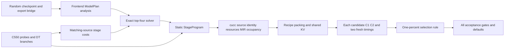

# MX-5 C550 pipeline and specification audit

Verified checkpoint, 2026-10-28: A19 body `7c9658ac5`, frozen normal producer
`88327cbc4`, has11/25 dense top-four selections. Eight are nonregressions;
Qwen0.6B B2/B4 andQwen1.7B B2 are9.823/7.591/1.538% slower than fixedMX4;G-LLM stays open.
Current consumed-prefetch4b7d83686/producer230a572b has4 earlier L2-prefill measurements;1/25 aligned L1-prefill selections. Earlier L2 results: Llama1B B1
2.135062ms(−3.438%);QwenB1=1.973800ms(−.492%,indistinguishable);Llama1BB16=3.006219ms(−12.490%).
QwenB16=3.517390ms(−22.475%). Aligned L1 Llama1B B2=2.264237ms(−.342%,indistinguishable).
500A costs/25scopes pass;MoE0/5,DNN0/25 unfinished.

Authority: `/root/Prompt/TileMega_MX5_prompt.md`, SHA256
`75431f98a6286063cc73effe5ece2ed3d462304de4c4192dbd4023efe2bd6f73`.
Actual repository: `/root/tilemega`; initial HEAD `22a352242` on `tilemega-metax`.
Verified means inspected/executed here; stated means supplied instruction;
inferred means an interpretation. Earlier source cohorts remain in append-only
CSVs and git history; they do not count as a later body's acceptance.

## Current dense pipeline (verified)

MX4 standard measure defaults prefill toL1. Earlier explicitL2 timing was a harness
deviation;allfour rows remain preserved but are outside aligned final acceptance.
The final default edge remains open. The global target still selects the MX-4
cost table; explicit v2 configuration selects the development native route.

| Step | Implementation and evidence boundary |
|---|---|
| Export | `mx_serving_cell.sh` creates decode/prefill bridge JSON. All five dense checkpoints and MoE-L24 export/checkpoint exist. Export alone is not native execution. |
| Analysis | `compile.cpp` routes xcore1000 decoder/decode to `mx_decode::TryCompile`. Dense imports `ModelPlan` and analyzes shapes. `mx_decode.cpp:105` still returns -1 for DM plans; MoE native routing is unfinished. |
| Cost data | Current A20 pool reuses byte-identical G14/H15 evidence (3395 GEMM,750 head) and adds400 new512 attention keys, each three fresh processes. All25 scopes and independent top4 previews replay successfully. Another100576 attention keys were measured;300 failed resources and were not numerically executed. A cost scope does not authorize a plan thread shape. |
| Solver | Prescribed legal coordinates, five-length attention interpolation averaged over L65..1087, exact k-best top4. The source-bound Python resolved runner executes the four original candidates with preserved IDs and per-plan resource histories. |
| Codegen | `StageProgram` and `MxDecodeProgramV2` emit constexpr body types, direct calls and by-value bindings. No runtime stage descriptors. QKV(kStore), attention, O, gate_up, down, head give 5L+1 barriers. |
| Embedding and edges | Layer0 QKV reads the token embedding; layer0 O reads that residual. DownLast prefetches head; head prefetches next-step layer0 QKV weights. First token broadcast precedes entrance prefetch; later broadcasts follow grid acquire. |
| GEMM | Swapped MMA direction, prescribed TileRange/StreamK geometry, actual bounded ring refill, early residual, consumer RMS, fixed-order reductions and LA v2. TN/WN/D/Part/Pw are executed coordinates. |
| Attention | Single runtime-block-count body; block stream-K, online softmax, q/k transform, owned full-block cache writes, fixed-order wave merge and last-arriver partial merge. No Dispatch chain. |
| Head | Register argmax across tiles, one CTA reduction and parallel final partial loading; ties take the lower index. |
| Synchronization | DT-W/R/P/X/KV = 576 / role fence+atomic / P-B / X-A / block fragments. Per-plan 512 exceptions require their actual bounded history. Every grid barrier owns a 64B monotonic counter. |
| Build gates | Normal compile flags, source/archive/CU/macro/binary identity; frame0, static-smem0, MT≤227/255, actual one-CTA occupancy and selected steady-loop MIR checks. A failed build/query is retained and never treated as a timing. |
| Packing | `serving/weights.py` executes actual recipes and tile_pages packing, checks recipe conflicts and deduplicates shared weights. KV physical storage and capacity must match prefill/decode. |
| Prefill | Dense retains MX-4 geometry; WD0 timing and WD1 checks are separate artifacts. DT-KV block-fragment writes are required for the shared cache. TTFT is measured, not optimized. |
| Runtime | `DecodeRuntimeV2` retains L1/launch_steps ABI; `execution.py` resolves mx_static to L1. `ServingEngine` binds weights and shared request storage, runs prefill, then separate or device-loop decode. |
| Acceptance | Each original top4 candidate passes 512-step C-1/C-2 and two fresh WD0 timing processes, warm1/timed2, ISL64/OSL1024, greedy BF16. The fastest replaces prediction0 only if at least1% faster. |

Kernel-bound terminal packet scope and stage-local address-space binding reloads
are recorded integration differences in `MX5_integration_c550.md`. They are not
permission to change layouts, arithmetic, search coordinates or numerical gates.

## Decisions and amendments (verified / stated)

| Item | Evidence | Applied branch |
|---|---|---|
| DT-W | Poll N8/N0=12.65; arrival=9.04 | 576 synchronization wave; individually justified 512 exceptions |
| DT-R | Release atomic N8/N0=9.39 | Synchronization-role fence+atomicAdd |
| DT-P | CTA increase750ns > 387ns threshold; LDS increase−20ns | P-B with LDS generation release |
| DT-X | Wave exchange increase−20ns and no global wait there | X-A |
| DT-KV | Minimum K/W=.507, Vt/W=.363 | Full32-token block-fragment layout |

The user authorized the probed LDS-only primitive for local pure-LDS publication
and workspace reuse. Global P-B release/acquire and LA/global publication remain.
Five-fresh helper litmus covers 104CTAs×2000 iterations per process. The two local
LDS P-PAIR results (+.146%,−.300%) were indistinguishable, not demonstrated gains.

The user waived the original60-card-hour total cutoff on 2026-10-28. Cumulative
accounting continues; allowed cards7/6/5/4, at most two cards, one job/card, guard,
1800s job and900s timing caps remain. Current own jobs use6/5;all cumulative card time remains in the ledger. No clocks, power,
driver or other processes are changed; fixed external baselines are not rerun.

Original R_cap220/248 and prefetch formulas remain. A proposed R_cap160 change
has not been applied. The committed attention lifetime repair retains both caps.

## Open gates and next work (verified)

1. G-B remains open. The original576 GEMM seeded criterion fails one element:
   21.75 vs22.125, error.375 > tolerance.374000013. Native instrumentation preserves
   the complete original output. Observed normalized gate lies1.192e−6 below a
   BF16 midpoint while the CPU reference lies2.861e−6 above. No oracle, tolerance
   or seed was changed; this is localization evidence, not a repaired gate.
2. The old Llama1B576 PK2 self-next bench has44–48B frame despite a real
   whole-program167MT/frame0/resident1. This never justified blanket512. The
   consumed-prefetch repair has139/141MT/frame0/actualresident1. Full336, null28,
   helper6 andcoldselfnext12 each pass5fresh;normalproducer230a572b passes160/160;500 new attention costs are complete.
3. True576 Llama1B B2/B4/B8 watchdog builds fail16/24/56B before numerical launch;
   their timing originals fit. Isolated lifetime/lazy-record diagnostics are not adopted.
   G-PROGRAM/G-SOLVER/G-LLM remain open. A19 has11 measured cells and three
   regressions. B2 DIAG attention is35.923/35.842us versus bench27.167us. Three
   fresh off-grid diagnostics explain much of the prediction gap; the mandated
   five-point grid/formula is unchanged. Current-source I1 timing remains pending.
4. Complete all25 dense selections, then implement MoE analysis, router/top-k,
   dispatch, grouped GEMMs, combine, prompt64 and routing validation, five batches.
   Legacy MoE is not an accepted native result.
5. Complete LLM30 acceptance and CP-5 before native DNN execution. Implement
   forward ABI, all native bodies, register epilogues/layouts, cost table/top4,
   time command,25 synthetic checks and25 forward timings. Only DT-F may be cut
   for budget; its adoption still requires the prescribed P-PAIR evidence.
6. Final xcore1000 MoE/DNN legacy compile-time rejection is unfinished. The nine
   pre-existing legacy legality tests listed in MX-1 remain outside this repair.

Main results: `MX5_c550.md`, `MX5_llm_c550.md` and the append-only CSVs.
Detailed amendments: `MX5_scope_reaudit_20261027.md`, `MX5_local_lds_c550.md`.
The full task, all55 cells and final default promotion are not complete.
