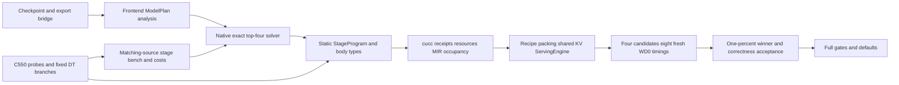

# MX-5 C550 pipeline and specification audit

Current checkpoint: `cc29d78304` bodies with frozen producer `24fa50ed`,
seven completed dense top-four selections. The five development cells beat MX4;
Qwen0.6B B2/B4 are10.6205/8.6402% slower and require D7. All five development diagnostic ledgers plus B2 D7
are complete. MoE/DNN native remain unimplemented.
The detailed audit below includes explicitly historical development evidence;
current selections are in `MX5_llm_c550.md`. **Verified** means inspected
source or executed evidence; **inferred** means interpretation. Authority is
`/root/Prompt/TileMega_MX5_prompt.md`, SHA256
`75431f98a6286063cc73effe5ece2ed3d462304de4c4192dbd4023efe2bd6f73`.
The workspace actually uses `/root/tilemega` and `/root/Prompt`; this path
variation is recorded, not a change of implementation authority.

## Current pipeline (verified)

This diagram describes the native dense route. Seven current-source cells have
completed exact top-four selection; full acceptance and the default edge remain open.

| Step | Current implementation and limit |
|---|---|
| Export | `scripts/mx_serving_cell.sh` produces decode/prefill bridge JSON from random-weight checkpoints. Dense has five models; MoE-L24 export/checkpoint also exists. Export is not native execution. |
| Frontend | `compile.cpp` routes xcore1000 decoder/decode JSON to `mx_decode::TryCompile`. Dense uses `BuildModelPlan`, import and `AnalyzeMxDecode`; DM MoE analysis/native routing remains unfinished. |
| Solver inputs | `configs/targets/xcore1000.json` still points to the MX-4 decode cost table. An explicit v2 solve flag consumes qualified schema2 costs. Schema3 has an explicit diagnostic complete cost-or-rejection route; the C++ results route rejects it; an explicit Python ResolvedTop4 v2 consumer now checks genuine proofs, executes four candidates and publishes their measured winner. |
| Selection | `MxDecodeSolverV2` enumerates the prescribed geometry, averages interpolated attention cost across past64..1086, and merges exact top4. Preview IDs/ranks/evidence are retained. Whole-program resource failures and justified thread choice remain required before final measurement consumption. |
| Static code | `StageProgram` and `MxDecodeProgramV2` emit constexpr body types and direct calls, without runtime stage descriptors. Dense uses qkv(kStore), attention, O, gate_up, down and head; embed is folded into layer0. There are5L+1 counters/barriers per decode step. |
| Edges | DownLast prefetches head; head prefetches next-step layer0 QKV weights. Token broadcast happens after grid acquire; first token broadcast precedes entrance prefetch. Terminal packet lexical scope and stage-local AS4 binding reloads are recorded departures in the integration report. |
| Synchronization | Selected DT-W/R/P/X/KV =576 / role fence+atomic / P-B / X-A / block_fragments. `StageSyncV2` uses LDS generation release; `LastArriverV2` uses last-only acquire. Each barrier has its own64B counter, monotonic across steps. Diagnosed per-plan512 selections execute outside the576 shape; Llama1B B1 uses576. |
| Bodies | GEMM/head/attention v2 are shared by generated programs and benches. `3843f6477` guards GEMM weight Prefetch for inactive/chunkless waves. `5c032c501` schedules statistics expansion after MMA consumption. Attention scalar sharing was rejected; ca678cbc8 uses fixed8 partial-O batches after a distinguishable2.16% E2E improvement;2dbf763ab shares packed gamma dependencies after a further2.44% gain. |
| Build identity | Native compilation retains actual compile receipts, source snapshots, CU, macro capture, resource log and binary identity. Normal resource gates require frame0/static-smem0 and MT≤227/255, plus actual one-CTA occupancy. Forced-register diagnostics never qualify for execution. |
| Weights | `serving/weights.py` executes exported recipes and `tile_pages(xcore_mma,TN,32)` packing, checks conflicting recipes and deduplicates by source/recipe identity. Actual packing coordinates must match the executed types. |
| Prefill and KV | Dense retains MX-4 prefill geometry, watchdog0 for timing and watchdog1 twins for checks. DT-KV requires full32-token fragment writes. Prefill/decode share request backing storage; `engine.py` now checks physical `kv_storage` as well as `kv_layout`, sequence and capacity. |
| Runtime | `DecodeRuntimeV2` supplies L1/launch_steps ABI. `execution.py` resolves mx_static to L1. Binding and launch controls enter the kernel by value; hot global accesses use explicit address spaces. Engine executes one prefill followed by separate or device-loop decode. |
| Validation | C-1 uses512 teacher-forcing steps against HF; C-2 requires exact separate/loop tokens. Timing uses64/1024, greedy BF16, fresh processes, warm1+timed2, step-events0 and TPOT=(E2E−TTFT)/1023. Diagnostic skips/step clocks are attribution evidence. |
| Defaults | Default dense remains MX-4 static decode. Explicit v2 resource failure throws rather than interpreting the plan. MoE/DNN still have legacy paths; their final native implementation and compile-time legacy rejection remain required work. |

## Evidence boundary (verified)

- G-A passes. G-B/G-PROGRAM/G-SOLVER/G-LLM remain open. Existing default target/pins
  have not been promoted to MX-5 final results.
- Five older native development controls pass512-step C-1/C-2. Old-source
  schema2 has4545 keys with three fresh measurements each. Neither fact
  substitutes for final source qualification and25-cell selection.
- Llama1B B1 has a real fitting minimum576 plan, so blanket512 is invalid.
  Its old-source complete domain has154 measured keys+35 resource rejections,
  with no missing key or invented rejection latency. Schema3 is diagnostic.
- Some576 plans spill at the toolchain's observed168 allocation budget despite
  the nominal AP-total227 bound. This discrepancy and candidate-bound D7
  evidence are recorded. It does not prove a body-level register lower bound.
- Eight admitted idle-Prefetch unit families each pass5 fresh processes
  (40/40), including full512 numerical matrices and512/576 chains. Rejected
  complete576 families were retained and never run.
- The real idle-fix QwenB1 WD0/WD1 plans are MT251/255,frame0,resident1;
  both have15 clean MIR rings. C-1/C-2 passes512 steps; generated tokens equal
  the old control exactly. Same-card P-PAIR medians old/fix are
  2.026787953/2.034753758ms (+0.393%, indistinguishable). The fix is still about
  2.58% slower than stored MX-4; performance acceptance remains open.
- Attention scalar reuse passes real512-step C-1/C-2 but P-PAIR increases
  0.384% (indistinguishable); it is not adopted. GU+Consume passes25/25 fresh
  complete512 unit-family jobs and QwenB1/8BB16 original1 C-1/C-2.
- GU+Consume fixes8BB16 original1/3 allPw=D to241/frame0 (WD0). The new1B576
  control is152/frame0;8BB1 originalGU8 fits245/frame0 without reduction.
  These are manual controls requiring individual root execution evidence.
- Qwen GU/Consume P-PAIR is2.034798772/2.053543765ms (+0.921%, indistinguishable),
  still above stored MX-4. Its fixed8 descendant is2.007555ms (+1.21% vs MX-4), so the gate stays open. G/H archives remain exact; new A costs are required.

## Whole-spec checklist

1. Keep order: stage0 → dense → MoE → LLM30 acceptance → DNN25. Development
   integration/calibration overlap is recorded; gates are not waived.
2. Dense covers five models×B1/2/4/8/16. MoE covers24-layer Qwen30B-A3B at the
   same batches. DNN covers ResNet18, MBV1/2, BERT S128 and NAFNet-w32 256².
3. Implement §3–§8 structures/layouts/rounding as specified. Only measured DT
   branches, bounded register reductions and DT-F provide the prescribed
   alternatives. Failed artifacts and source differences remain explicit.
4. Rebuild P0/derived widths and three-process stage costs for the actual body
   source. Every coordinate/row must execute in code. Select each final cell
   through exact top4 E2E measurements and the1% rule; report pred/meas.
5. Implement MoE native analysis, router/dispatch, grouped GEMMs/combine,
   prompt64 program, packing and routing check. Then accept25 dense+5 MoE
   cells against the stored baselines before starting native DNN execution.
6. Implement DNN native forward ABI/bodies/generator/solver/time command;
   pass all25 synthetic-weight checks and collect all25 forward timings.
   Only the two DT-F fusion experiments may be cut for budget.
7. GPU work stays guarded on7/6/5/4, at most two cards and one job per card;
   job≤1800s, timing≤900s, MoE needs40960MiB. No external baseline remeasure,
   clock/power/driver change, or use of cards0–3.
8. Budget60 card-hours; count all three job logs by canonical distinct output.
   At2026-10-26T12:44:22+08:00:685 closed/2 active, wrapper-wall upper bound
   20.798983 card-hours. Raw artifacts stay under ignored runs; committed
   measurements append round/executor/implementation without rewriting rows.

Current raw paths, failures, source identities, detailed stage ledger and the
remaining acceptance work are in `MX5_integration_c550.md` and the CSVs.

Verified continuation: all76 GU+Consume P0 libraries compile;8290 G/H zero-launch
queries complete.120 G/H primary libraries are authorized from their actual
references. Old A controls stay separate; all16 A8 P0 builds and800 zero-launch queries are complete.
ResolvedTop431 CPU tests pass; unknown previous576 reductions block512
consumption. Canonical576/D7/Resolvedv2 CPU protocols are implemented;90 related root tests
pass. Explicit runner/results/script consumption is implemented by2852cad5b;25
root integration tests pass. It still needs genuine current tables and all four
candidate proofs; no real final selection has run. G/H primary queries and
conditional retry queries are complete;576 final selection/campaigns are being
closed without changing failed rows. Gamma scheduling passes5fresh full A/legacy bitwise jobs,C1/C2 and P-PAIR:
2.007205873→1.958246937ms,−2.439%,distinguishable; adopted by2dbf763ab.
QwenB1 is now−1.276% versus MX-4; all5 development controls now pass C1/C2 and timing.
A16 P0 and8primary actual800 queries each give512400fit/576100fit+300reject;
Canonical per-candidate histories and final solver selection remain pending. G/H sources remain exact.

Verified12b5ab839: unified50-scope catalog adapter/global unique GH diagnostic
fit implemented; normal C++build/unit and50 rootPython checks pass. Default
target routing/proof production still await real complete data. No final table
or candidate selection is claimed.

Verified continuation: QwenB1/B16 current A diag/bench ratios1.04893/1.00031;
B16 A65.581us exceeds AppendixA26–28us. It is a manual diagnostic control,
not final selection. Current full-domain qualification and other3 ledgers remain
open. H512 costs run on7; ledger then remainingG512 on6; each card has its
admitted576 cost campaign queued behind successful completion. At15:56:47
Shanghai the3-log wrapper-wall upper bound is26.929817/60card-hours.

Verified4c7/ab27/0a017: normal actual576 diagnostic stepper,independenttrue576
original preparer and exactactualP0pool projector are implemented. Root46,
50(+1optional skip),28 relatedCPUchecks pass;actual4545P0audit createsno
origin/bundle/cost. Sharedqualification tools remain byte-exact. Frozen clean
d74 producer buildsall160normalsteps/CPPunit;normalQwenCU/device.text match.
Remaining40prefill builds startfromliteralcurrentpins;QwenB2WD0/1exactgates
and actualfinalL1API0/resident1/thread128 queriespass;other38continue.
Nativeorigins/widthcost/D7/finaltop4/defaults remain genuine-evidence work.

Verified currentfull5compactledgers80jobscomplete;newA57.941usbench vs
8BB16net60.660ratio1.047.18frozen-d74prefills compiledandfinalL1queried,
plus10historical. Oldremaining22cohort stoppedafterownB4CPUISLprefix-sum
pathology;exacthostseeded-Sum fix3ef passes3relatednormalCPUregressions.
Newnormalfullproducer3efbuilt,headerclosuresunchanged;controlCU/resources
comparison remains pending before remaining22new-epoch builds.

Verified19:00 continuation: genuine512-only25scopedtables4545costs/191batches
areconsumer-replayed;allfive actualdevelopmenttop4previewsnowexist. Real
QwenB1canonical576historiespreserve originalframes448/448/440/436 and
headPw reductionframes364;positiveoccupancydoesnotwaiveframe0. Actual512
originalIDs2/3MT241/239frame0stillneedquery/D7/C1/C2/top4E2E. Otherfour
developmentcells16normalcanonicalbuildscontinue. Currentprefillremaining22
has19PASS;old/newcontrolCU/resourcesmatch. Full576costs/true576solverorigin,
final25selectionandallMoE/DNNworkremainopen. Budgetcheckpoint34.425559/60.

Verified first actual selected cell: Qwen0.6B B1 original0,TPOT1.944021ms,
−1.993% vs MX4,/SGLang0.790928,pred/meas1.023797. Allfour source-qualified
originals passed C1/C2512 and8freshWD0process measurements;selected binaries
and exactexecutedpin are reviewable,globaldefaultremainsMX4. The50prefill
matrixnowuses18d74+32new3ef libraries,allstrictfullsnapshot/WDrole/finalL1
API0positive queriesPASS. Historical10old-root snapshotfailureswere preserved
andexcluded ratherthanwaived. Five trueMX4finalPPAIRproofs remainmissing:
oldproducerarchive unavailable,currentrootfullsnapshotfails;storedMX4CSV
comparisonsremainvalidandnoexternalbaselineis remeasured. FullLLM/DNN gates
remainopen. GPU6/7currentlyserveactual B16/B1 top4 respectively;ownstage-cost
queuecontrollers resumeautomatically aftereachactualrunner exits.

Verified continuation: second qualified dense cell Qwen0.6B B16 selects original0.
Allfour C1/C2512 pass;8 fresh WD0 timing processes on6 give median3.567243ms,
−21.3758%vsMX4,/fastest0.887308(vLLM),pred/meas1.020646.
Original candidate IDs, immutable failed histories, executed pin metadata and
source-qualified WD0/1 binaries are retained. Default remains off; 2/25 dense,
0/5 MoE and0/25 DNN complete. Four resource/correctness/selection rows plus
three serving rows append; earlier committed CSV byte prefixes are unchanged.

Verified Llama3.2-1B B1 true576 scope:189 keys=156cost+33 formalrejections,
zero missing. Seven fresh guarded batches allpass; original completeA100
campaign retained unchanged. Native e613 independently emits true576top4 in
llama1b_true576_native_origin_v1; no512 rank/cost/pin transfer.
Llama8BB1 actualfour source-bound D7/ResolvedTop4 pass; ROOT starts C1/C2
and8 timings on6, pausing only its own G queue controller and automatically
resuming that controller on actual runner exit. Existing GPU child continues.

Verified Llama8BB16 candidate2's sole remaining prescribed DownPw4→2 retry
still givesMT256/frame104. Three shared reductions exhausted; no execution,
extra reduction, fifth candidate or budget reset. Generated text changed, so
this physical coordinate took effect. Two isolated CPU diagnostics preserve
failures: literal prompt4.3 head scope givesMT256/frame480; moving only internal
Binding invariant fields before the layer array givesMT256/frame112. Neither
repairs resource legality; no diagnostic is a native selection or code change.
MIR suggests control/address liveness but does not establish an allocator defect
or a physical register lower bound. This item remains stopped (resources gate:
python/tilemega/mx5_resources.py:121; generated candidate artifact1 retained).

Verified old head576 job12 guard rejects with rc75, reason running interference;
its partial rounds are excluded. Available journal does not establish the cause.
No guard threshold was changed. New complete650-key/28batch H campaign runs
on7; first288 previously valid keys are remeasured and count against budget.
Original failed campaign/exporter bindings stay immutable. A new CPU waiter
requires all114G and28 newH successful batches before derived full50 export.
At21:46:22 Shanghai conservative three-log union is45.871173/60card-hours,
including queue/cooldown elapsed. All actual GPU execution remains on6/7.

Verified additional stopped item: independent512 Llama8B B8 original0 hasMT256,
frame0, allfive Pw=D. Strict512cap255 rejects it (mx5_resources.py:119);
no legal width reduction remains even though unused numeric retry budget exists.
The original native candidate stays in the top4; no replacement/threshold waiver
or execution is made. OtherB8originals and independent cells continue their own
resource checks. Root cause is not established. Raw ACTUAL_STOPPED_ITEMS.json
under runs/mx5/checkpoint_actual_resource_defects_v1 preserves both B8 andB16.

Verified budget accounting refinement at22:08:54 Shanghai: sum of physical-card
wrapper interval unions is38.253330/60card-hours, versus old per-wrapper sum
47.177215h. Overlapping same-card queued wrappers cannot execute simultaneously
because all hold the same exclusive GPU lock; interval union removes only this
double-counted overlap. It still includes preflight/cooldown/CPU overhead and
active elapsed; closed endpoints add1s for integer-log precision. Peak interval
concurrency2cards. Initial4/5 guard preflights are included (0.007778h each);
current execution remains6/7. Three original log snapshots and every old ledger
are preserved; no performance row changed. Reproducer and interval witnesses:
runs/mx5/checkpoint_physical_budget_refresh_v1/physical_union/.

Verified cc29d7830 integration repair: actual allocated CFG carries Attention
K/V slots across Head; no allocator-bug or physical lower-bound claim. Isolated
normal same-last-pin CPU compile changes only Run-local Block to value-initialized
Block{}: Llama8B B16 original2 after last legal DownPw4→2 goes fromMT256/frame104
toMT241/frame0. Diagnostic text209216B; main/frozen were not edited during probe,
no GPU launch or eligible identity. Old failures and three-reduction budget stay.
The source change defines unused local slots, leaves valid=false and global
issue/synchronization/arithmetic coordinates unchanged; actual MIR, numerical,
occupancy and E2E gates still required. Normal newproducer/2samepin regressions
are building in a new clean cc29 worktree. Source-closure tar inspection proves
G14/H15 unchanged, onlyA19 changes. New A P0/primary/cost qualification is required;
old selected cells and active old-A runner remain valid only for their recorded
source cohort. No old A cost is relabelled, no old result promoted to new source.
The pending pure-CPU old512-query waiter was stopped before any GPU launch;
existing original builds/histories and G/H measurements remain preserved.

Verified newcc29 producer24fa50ed913bce7791f575447a97e06c18a9bfce91c337c0bcc9191179c7c3c7:
160/160freshnormalhoststeps,CPPunit/fingerprintPASS. Same-last-pin WD0/1
B16c2MT241/frame0 and B8c0MT225/frame0,14cleanMIRrings each;allfour actual
queries API0/resident1/noLaunch+guard0. Both actualWD1 C1/C2512 checksPASS;
B16maxgap0.34375. No extra width retry/budget reset or finalselection claim.
Newsource A19=719ac288910e2e658a83f49508530c6c4e3b37e44f658d81fae01da53b02acc4.
Actualnew800P0queries allAPI0/noLaunch:500fit/300reject. Actualplanner800
runsafterthese realparents;only5missing primarylibs built,3PK0newP0libs reused.
Primaryactualqueries/unitnumerics/timings/solver stillpending;oldA not mixed.

Verified old3ef/Af8 Llama8BB1 selection now complete: allfourC1/C2512 and
8freshWD0timingsPASS;1%anchor original0,median10.560823ms,−1.443774%vsMX4,
/SGLang0.952309,pred/meas0.983791. Rawselected binaries/pin published under
tm/llama3_1_8b/B1 andconfigs/pins/mx5. This is a third prior-body result,
not newcc29 acceptance. Four selection/correctness/WD1resource and3serving
rows append;4newcc29 actualquery resource and2newC1C2 rows append separately.

Verified width-cost v1 guardfails due relativeoutput/childcwd path mismatch;
v2 guardfails at run_three_fresh.py:36 after3head+1G childsuccess because
G usesworking_set_bytes whileH usesactive_working_set_bytes. Bothsealed
scripts/raw/partialoutputs anderrors retained,zero qualifiedrows, nopartial
reuse. Newkind-specific schemaadapter will beCPU-reviewed in a newdirectory;
no thirdGPUattempt while obsolete old-A-family widths are not required by
newsource actualledger. No256MiB/3fresh/guard criterion is relaxed.

Verified newcc29 development controls: B16 same-last-pin2 WD0 TPOT rounds
13.213834/13.223578ms,median13.218706ms,−9.094788%vsMX4,manual/notselection.
Llama1BB1 sameoriginal576pin WD0/1 bothMT164/frame0;actualAPI0/resident1
queries0launch;C1/C2512PASS,maxgap0.09375. TPOT2.152834/2.153921ms,
median2.153378ms,−2.609387%vsMX4,manual/notselection. Ownqueuecontrollers
resumed afterboth workflows;raw/failures/oldwidthbudgets preserved.
New512 A family5freshrounds eachpasses full1008cases×2 plus2legacybitwise
helpers, no skips. Complete576family remains resource-blocked,not a pass.

Verified literal steadyloop audit:6 complete Sᵀ/PV block natural loops each
have34CFGblocks,16+16staticMMA sites,zeroARRIVE4160/BARRIER. This gatepasses.
Unfinished prompt4.7.3 claim: acrosssegment K/V cannot remain in-flight through
segment merge with selectedP-B CTA synchronization. DecodeAttentionV2.h:318
calls StageSyncV2.cuh:18(__syncthreads);programMIR10450/bench66260 has4160
beforemerge. ConcreteB16/hkv8/L512/bmin4 CTA4 range[78,98):head4blocks14..15,
head5blocks0..15,head6blocks0..1;head5wave0/1prefetch head6 then fullwait.
No crosssegment-overlap success claim, timing-cause estimate, synchronization
substitution or fullpipeline compliance claim. This optimization itemstops;
closest prescribed P-B source remains the subject of honest calibration.
Rawaudit: blockinit_attention_outer_loop_wait_audit_v1_61/DELIVERY.json
SHAce60e84aef987e4a611c0e13eceffd425d09a7044884474a3efd7e43fa5a4ad5.

At23:47:43Shanghai physical-card interval union upper41.536622/60h;
oldwrapper sum53.703244h preserved,peak2cards. Rawcheckpoint:
runs/mx5/checkpoint_blockinit_units_and_manuals_v1/physical_union/.

Verified cc29 five development numerical/timing predicates allPASS:
QwenB1/B16=1.945727/3.573892ms (−1.907/−21.229%MX4),
Llama1BB1 576threads=2.153378ms(−2.609%),
Llama8BB1/B16=10.557096/13.218706ms(−1.479/−9.095%).
AllC1/C2512;twofreshWD0 processes percell. These aremanual controls, not
newsolver selections;fullconformance/LLM gate stillopen forrecorded gaps.
Six extra normal controls actualAPI0/resident1 queriesappendresources257→263;
new3C1rows58→61 and6timingrows80→86 appendwithout alteringoldbytes.
Proof:blockinit_five_development_predicates_v1/ACTUAL_FIVE_DEV_PREDICATES.json.

Verified new512 seventeenactualbatches complete;originalq.qualify gives4545
exactG3395/H750/newA400 pool. Initialexport thenfailsat consumer binding
lookup(export512.py:62), leavingzero nativepreviews;oldpartialpool/log/rc1
preserved. Newcorrected_export_v2 addsactualmain consumer+120Python source
closure andkeeps originaldependencies/4sharedtoolhashes;preflightsimports
beforeanyoutput,thenreplays actualqualification into a newdirectory. No
oldpool successindex fabricated,noGPU rerun/row rewrite/gate waiver.
Five576A batches continue;oldH3015698 stays paused underremaining21controller
andwillresume automatically;G2636562resumed after manualcontrols.

Verified newA719 calibration: all500 fit keys completed original three-fresh
batches. Corrected512 exporter actualrc0 qualifies4545 exact G3395/H750/A400
rows and25 consumer-replayed scopes. v1 consumer-binding failure is preserved;
v2 binds the actual consumer/Python closure before writes. TABLE_INDEX SHA
3305380f2ae168e74bed89fb08660cc2eb0471674763cf6715908cef2fe8ad3e.
Normal24fa/cc29 CPUsolves produce25 scopes/100 original512 candidates with
strict validators PASS; ACTUAL_ORIGIN_INDEX25 SHA
fc7c962736526b9541fac9f00dd9626b63b7ff858a97c84217d22232a5254273.
This confers no device resource approval, candidate execution or final selection.
Independent Llama1BB1 576 solve also actualrc0 from genuine G815/H52/A719
scope156costs+33formalrejects; tableSHA241654a712ac929f71ddb0b8e7f1253c9623d7d62ca1ba2f7e3ba9851db01358.
Canonical576 and independent576 original builds proceed in separate histories.
At00:53:25Shanghai physical-card interval-union upper43.726747/60h,peak2;
oldwrapper sum56.750636h preserved in checkpoint_blockinit_origins25_v1.
G/H576 campaigns90/114 and22/28 closedguard0 atinspection; no missing cost
is projected. Newfull50 exporter binds actualconsumer closure and waits for
both genuine complete campaigns before publishing; oldA full50 stays separate.

Verified new Llama1BB1 independent576 four originals:normalMT164/frame0,
rings15/15/15/14, actual four guarded API0/resident1/no-launch queries and
strict true576 ResolvedTop4v2 READY. Firstroot delivery-reader map/list mistake
stopped beforeGPU; preserved and corrected reading originalseal unchanged.
NewQwenB1 allfour canonical576 histories terminate underactual shared counts;
allfour independent512 originals MT239/frame0 actual API0/resident1 queries
andconsume nowneed candidate-level D7. Eight new resource rows263→271 append
without changing old bytes; no current-source finalselection yet.
Normaldev20 allcompiled,3staticfit/17resourceveto; remaining80 CPU originals
continue. Staticfit never substitutes actual occupancy or permits512.
NewLlama1B top4 first operational run stops WD1query at330s outertimeout
while waiting behind ownH24+preflight, before C1/timing. Rawrc124/failedstate
arepreserved. v2 keeps exactsame four origins/proofs/pins/budget and waits
for already-dispatched own children to fully exit before starting the runner.
It is a scheduling retry, not a width retry/fifthcandidate or gate waiver.
Timeout wrapper lacked rawend; parentactual ended1793034730.0015185 is a
conservative closure proof. Newaccounting v2 bindsactualrc124 andparentexit,
preserveslogs;upper44.487019/60h at01:19:01,unclosedupper44.498130 retained.
ActualLlama1B original0 nowC1/C2512PASS,maxgap0.09375; other3/timing pending.

Verified first genuine current-source selection: cc29/A719 Llama1BB1,
independent576 original0. Four C1/C2512PASS (allmaxgap0.09375), eightfresh
WD0 processes complete. TPOT2.157002098435938ms,TTFT8.957553654909134ms,
E2E2.215570700354874s,462.183400tokens/s,MBU0.744871(inferredstreammodel),
−2.445%vsMX4,/SGLang0.8536835,/vLLM0.7231952,pred/meas1.010964.
All4original normal WD0/1 MT164/frame0,actualAPI0/resident1. Exactselected
pinunder configs/pins/mx5/blockinit_cc29,not a target/default switch.
Append-only export: serving9→12,selection20→24,correctness61→65;
resources271→275(QwenB16actualWD0queries)→279(Llama1BactualWD1checks).
Originalprefix proofseachretained. Newsource1/25;three prior-body selections
remain separate. NewQwenB1 all4D7/resourcebindings independentlyreplayedREADY;
itsactualC1/C2/top4 timingqueue follows Llama1B,with own previous-child drain.

Verified canonical100 new-source ordinary original resources append279→379:
100actualnormal cucc receipts0; native CLI14resourcefit/86resourceveto.
Rowsareexplicit compile-only observations without occupancy/execution claims;
positive615-input/sourcearchive/ordinaryflag/generatedcoordinate/MIR checks
andbinary/receipt/resource/snapshot hashes bind20+80actual manifests.
Old CSVbytes remainunchanged. Proof:canonical100_blockinit_resource_export_v1.
At01:56:34Shanghai actual-card unionupper45.322621/60h,oldwrappersum59.337543h
retained,peak2cards; checkpoint_first_newsource_selection_v1/physical_union.
Llama1B selected DIAG exact pin+PK2 CPU165/frame0,15cleanrings; rootactual
ledger queuecard6 usesoneguardedzeroquery andtwo900s guardedrounds with
eight serialfresh children each,reversedmaskorder inround2. DIAGtiming is
nonadditive attribution only; noledger result claimed beforeactualcompletion.

Verified second current-source selection: Qwen0.6BB1 original0/512,
TPOT1.954393515969651ms,TTFT9.28496802225709ms,E2E2.0086295348592103s,
509.800330tokens/s,MBU0.415286(inferred),−1.470008%vsMX4,
/SGLang0.7951477,/vLLM0.6357198,pred/meas1.0215598. Candidate3 has
lowestmedian1.953755908ms but remains<1% faster thananchor0; retain0.
FourC1/C2512PASS,maxgap0.015625;eightactualfreshWD0processes.
Sourcecc29/A7192/25;source-specific pinunderblockinit_cc29,default unchanged.
Actual selectedLlama1B ledger16fresh/2rounds completes oncard6. Netus/layer
QKV9.708/A13.609/O6.078/GU43.138/Down21.335 againstmatchinguntraced
bench12.510/15.195/10.160/52.660/25.340. Head/tokenhistory-confounded
net317.360us vsbench326.810;commonmask63floor341.048us/step retains
prefetch/barriers/control/timer. All differences nonadditive,not purebody time;
no stage measured/bench>1.2. ExactPK2 selectedgeometry avoidsoldmanualPK0
missingbench. Fourteenledgerrows append114→128 witholdprefix proof.
New8BB1 normal512 fouractualqueries are222/frame0/resident1 each;
normalresource4plusselectedLlama1B DIAGquery165/frame0 appended379→384.

Verified thirdcurrent selection: Qwen0.6BB16 original0/512 TPOT3.580818852ms,
TTFT60.759784188ms,E2E3.723937470s,4399.644229tokens/s,MBU0.405194
(inferred),−21.076615%vsMX4,/vLLM0.89068449,/SGLang0.82385856,
pred/meas1.01695547. All4 C1/C2512+8actualfreshWD0PASS; sourcecc29/A7193/25.
NewQwenB1 selectedledger16fresh completes: netus/layer6.723/23.151/4.704/
9.823/6.566 versusmatcheduntracedbench10.100/22.070/8.360/13.770/10.030.
Head/tokenhistorynet190.933usvsbench195.300;mask63floor331.180us/step
retainscommonprefetch/barrier/control/timer. Nonadditive,no purebodyclaim;
attentionratio1.0490,beyondappendixinference,butnofabricatedsite-time split.
SelectedQwenledger14rows append128→142; priorbytes preserved.
Normalnew8BB16 fouractualresourcequeries223/223/241/223 frame0/resident1
and16controlledcapqueries appended388→408. All16capAPI0/resident0/noLaunch;
8BB16cap0/1/3frame0,cap2frame104;staticspilldisappearancedoesnotpermit
execution. CurrentMOEreadonlyaudit confirms16diverseprompts,48historical
baselineoutputfiles andunknownactualroutingdistribution; no baseline rerun.

Verified checkpoint 2026-10-27: current selected QwenB1 ledger DIAG library
is MT235/frame0, actual API0/resident1, query-only; its resource row is
diagnostic-only. Five further cells have real four-candidate D7/protocol
READY and are independently replayed/queued after the two8B development cells.
Physical-card interval-union budget47.47954/60h at03:29 Shanghai, including
guard preflight/CPU/cooldown. This does not close any outstanding gate.

Verified remaining-domain checkpoint: six further cells (Qwen0.6B B2/B4/B8,
Qwen1.7B B1/B2/B4) each have four actual normal512 occupancy queries and
four actual controlled227 diagnostic queries, all no-launch/API0. Normal
plans have frame0/resident1; all24 controls have resident0 and stay ineligible.
Forty-eight resource rows append413→461 with old-prefix proofs. The first
five protocols have root-independent all-four READY replays and explicit
card7 queues; the sixth has a root CPU replay watcher. These are not measured
selections. A cap-only reader stopped before append when no serving identity
sidecar existed; corrected reader uses actual native receipts/source/pins.

Verified fourth current-source selection: Llama8B B1 original0/512
TPOT10.574719905ms,TTFT41.277322453ms,−1.314088%vsMX4,pred/meas0.982385.
All4 C1/C2512+8fresh WD0 pass; original1 gain<1% retains anchor0.
Actual source-bound selected pin is preserved, including existing metadata;
no prior3ef measurement relabel/default change. 8BB16 now starts its own run.

Verified third selected ledger (Qwen0.6B B16):16fresh no-trace DIAG runs;
netus/layer9.425/65.835/8.621/12.743/12.820 againstmatching13.550/65.584/
11.810/16.410/15.570. Head/history199.857usvs199.670;mask63floor311.723us.
Nonadditive;attention net/bench1.003826, no fabricated per-site microseconds.
Ledger14rows append142→156; selectedDIAG239/frame0 realAPI0/resident1 row
appended separately from production. All old bytes retained.

The next unstarted cells use an explicit execution schema after root CPU review.
Prompt §5 keeps four candidates × two fresh timing processes; §7 requires
C-1/C-2 for each final selected cell. The earlier runner additionally checked
all four candidates. The new mode freezes the same 1% winner after all eight
normal timings, then builds/queries/checks that winner at512 steps. A failure
stops the cell; it never substitutes another candidate. Unselected correctness
is explicitly “not run.” Existing four-check results are retained as such.
The first-five old queue was stopped before any GPU/build/timing dispatch,
with real PID and zero-dispatch evidence. Existing active8B runs are unchanged.
Frozen helper/root replay passed27 CPU tests plus genuine saved proof replay;
new-schema GPU behavior is still unverified and not counted as acceptance.
Single-child900s timing guards are selected in advance; no inferred prior
per-cell duration is fabricated. Default, body source, costs and pins are unchanged.
Raw: `selected_only_execution_freeze_v1/`, `remaining20_selected_only_execution_v1/`.

Verified selected Llama8B B1 DIAG-only resource query: MT223/frame0, actual
API0/resident1/no-launch; row466→467. Its four guarded intervention batches
are still running; no completed ledger or production timing claim from DIAG.

Verified new-wrapper device query smoke: one real card6 guard and one fresh
query child passed actual coordinator/child/owner/flock/argv/artifact checks,
API0/resident1, zero kernel launches. Raw:`selected_only_real_query_guard_smoke_v1/`.
This validates wrapper provenance only, not timing or C1/C2 acceptance.

The read-only DNN audit is sealed (120 input hashes, no model build/GPU):
`runs/mx5/dnn_native_readonly_pipeline_audit_v1_61/REPORT.md`.
Verified boundaries for the later DNN implementation:

- `StageProgram.cpp:35` still requires a loop and tail; kForward is an enum,
  with no forward client/runtime. Actual native stage/barrier counts are unknown.
- `DnnDwPwFusion.cpp:23` auto eligibility also covers MBV2 DW→project;
  the actual unchanged planner, rather than an assumed1:1 count, governs stages.
- `dnn/check.py:49` compares recipe-packed external names, not literal raw
  checkpoint FQNs. Its call path includes copies/clones/synchronization and
  cannot simply be repeated as the native50-forward timing loop.
- `dnn/export.py:153` structure-only exports have no checkpoint; future timing
  must bind its actual random state/recipes. Export/check/baseline seeds differ;
  no byte-identical random state is claimed or external baseline remeasured.
- `dnn/check_generated.py:164` default checks use output cosine/NAF PSNR;
  exact required CLI checks remain mandatory, with no invented universal
  pointwise-BF16 gate or waived body arithmetic tests.

Native DNN is still unimplemented. This preparatory audit does not advance
past dense/MoE/LLM acceptance or authorize a legacy execution substitute.

Verified current selected QwenB1 normal source attribution now uses an exact
executable/allocated-section/resource/normalized-MIR-equal line-info twin.
All23 source buckets reconcile to kernel161560PC bytes and20469 allocated
MIR records. Six body unions total146560B/15851MIR; control8448/1018,
entry prefetch792/85, edges4040/404, operand setup1520/212, shared184/0,
unattributed16/2899. Stub32+alignment224 adds256B to device.text161816B.
Explicit body/context intersections are0; implicit semantic CSE sharing is not
excluded. Decoded ISA counts/current I1/cache latency stay unknown.
The normal build+validation wrapper's observed wall32.581196s is separately
labelled, not cucc-only. Two metadata rows append467→469; old unknown rows
are untouched. Raw:`selected_qwenB1_code_mapping_probe_v1_61/`.
Other selected plans require independent equality/mapping; no count transfer.

Verified fourth selected ledger (Llama8B B1): all16fresh interventions complete.
Netus/layer31.343/20.936/21.425/149.165/71.324 vsactualmatchingbench34.850/
18.622/24.920/149.750/76.540;head/history637.630usvs638.630us,floor718.590us.
Maximum net/bench1.124267; attention exceeds appendix inference but no
unmeasured site-time cause is assigned. Fourteen rows append156→170.
The main LLM report now renders all25 cells (pending explicit), actual top4
comparisons/coordinates and allselected ledgers; older expanded four-cell
detail is preserved in MX5_llm_development_details_c550.md.

Verified fifth development selection: 8BB16 original0/512 TPOT13.188281363ms,
−9.304018%vsMX4,pred/meas0.999310; all4 C1/C2512+8fresh PASS. Gate predicates
for allfive actual development selections now pass; structural gaps stay open.
The new selected-only schema genuinely completed QwenB2's8fresh timings and
fixed-winner full512 C1/C2 plus independent verification. TPOT2.318044591ms
versus fixed2.095492372ms is+10.620522%, distinguishably slower. Its numerical
checks pass but it fails nonregression; no gate/default promotion is claimed.
Root held only the future CPU E2E dispatcher for required D7; already-started
QwenB4 may complete. No GPU child was signalled. Source-matching QwenB2
DIAG preparation is underway, not a causal conclusion or fallback.

Verified seventh selection: Qwen0.6B B4 original0/512 TPOT2.601075282ms,
+8.640207% versus fixed MX4; pred/meas0.935351. Eight actual fresh timings,
winner full512 C1/C2 and independent verification pass. Root consumed the real
child exit0 through a separately recorded strict exporter; no original parent
completion or timestamp was fabricated. The future E2E CPU dispatcher is now
terminated after its B4 child exited, with no GPU child signalled. B2 and B4
remain explicit nonregression failures, not accepted defaults.

D7 read-only review confirms B2 crosses head boundaries at831/1023 actual
lengths, versus0/1023 for B1. Both have frame0 and actualPK0. Segment merge
at DecodeAttentionV2.h:318 invokes standard CTA synchronization and retires
carried KV, so the prompt's strong crosssegment overlap remains unmet. This
geometry/source evidence does not establish causal microseconds. Matching
selected-pin B2 diagnostic interventions are running; full regression cause
remains unknown.

The extra S5 primitive probe is CPU-prepared and queued after the actual B2
ledger: standard/bare CTA x512/576,5 fresh x2000x104. Root verified the full
21-file seal. It changes no production helper, DT-P branch, cost or default.
Separately,10 genuinely rebuilt22a reference decode artifacts passed actual
zero-launch API/occupancy queries (resident1); five paired linear-KV prefill
builds are queued after8BB16's ledger. P-PAIR and reference correctness remain
pending; fixed MX4/external baseline CSVs are unchanged.

Verified independent static mapping attempts for three further selected plans
are consumed append-only: QwenB16 kernel162360B/20487MIR and Llama1B576 B1
132344B/16969MIR each pass exact executable/section/resource/final-MIR equality
and complete23-bucket reconciliation. Llama8B B1's single line-info compile
produced different executable bytes despite equal size; its mapping stopped,
all per-body counts remain unknown, with no retry or transfer from another
plan. These observations establish no current I1/cache timing. Three resource
rows retain their independent source records and byte-gate proofs.

Verified selected QwenB2 D7 ledger is complete:16 genuine fresh processes,
two reverse-order rounds, no trace, actualchosen PK0/bmin4/512. Netus/layer
QKV/A/O/GU/down=7.518036/36.680000/5.067500/10.146071/7.050357,
matchingbench=10.08/27.509257/8.50/13.81/10.29;head/history190.205us
versus195.16us,floor63=334.980us. Attention net/bench1.333369 triggersD7;
values are nonadditive whole-step interventions, not isolated stage latency.
Adjacent lengths224/256/288 are queued against the exact existing A719/PF0
library with three fresh processes; official five-L table and candidates stay
unchanged. Regression cause and currentI1 remain unknown.

Verified isolated S5 extension: five genuine fresh processes each execute all
four std/bare x512/576 cases,2000 iterations x104CTAs,0 shared/KV/global-LA
checksum errors. At16KiB pending payload per compute wave, shared-phase
CTA/consume-tail medians(ns) are std5124870/2220,bare5122400/2240,
std5764690/2530,bare5762070/2560; original-LA phase5270/990,4980/1040,
5120/1160,4720/1210 respectively. Forty append-only per-process/phase rows
retain the actual binary/process refs. The global observable is an ordered
FP32 checksum, not exhaustive per-word global publication proof; real attention
math/owner masking is absent. DT-P staysP-B; no production sync replacement.
An initial fresh wrapper rejected duplicate --out flags before any binary
launch. Its raw failure remains; corrected parsing scopes guard flags before
the unique -- separator and passes actual saved-argv plus six CPU cases.
The kernel/source/binary/protocol/criteria were unchanged and not recompiled.

Verified fifth development ledger (selected8BB16) completed16fresh interventions:
netus/layer35.526/61.128/26.511/166.236/83.019 versus matchingbench37.620/
57.557/31.620/174.180/90.350;head/history655.180us versus656.700us. These
nonadditive interventions use the actual selected StreamK GU/down, not older
manual TileRange coordinates. Its attention net/bench1.062 is belowD7's1.2
threshold but remains above the appendix26–28us inference. Allfive actual
development selections now have source-matched complete ledgers.

Verified D7 adjacent-length diagnostic completed3fresh processes using the
unchanged A719/PK0/Q2/Norm1/B2/bmin4 library. L224 rounds34480/34880/34520ns
(median34520);L25622530/22530/22570(median22530);L28833970/33930/33940
(median33940). Every row passes repeated-context bits, historicalKV bits,
newK/reference assertions and barrier/LA counts. This establishes a local
geometry-associated cost step missed by smooth interpolation throughL256;
it does not allocate the whole-program36.68us marginal or proveI-cache cost.
Nine diagnostic probe rows append; official5L cost table/candidates unchanged.

A root implementation candidate changes only attention's First template into
a uniform runtime first_segment branch inside one head loop. Independent
actual-MIR review ofD128Q2/P0 shows8kernels with one32-MMA ring each versus
two32-MMA rings before,0private/generic/calls and frame0/MT<=249. Device.text
for this whole8kernel library is320344B versus600056B. An unchanged generated
B2 CU compiled with newheader uses241MT/frame0; that diagnostic is not a
source-qualified executable plan. SomeP1/P2 unit kernels spill and are not run.
P0 unit validation and diagnostic stage measurements are pending. Synchronization,
rounding, geometry and defaults are unchanged; crosssegment overlap stays open.

Verified candidate single-segment P0 units:5/5 fresh processes x56 cases pass
(D128,Q2,Norm0/1,B1/16,L1/31/32/33/65/257/1088,bmin1/8), with exact
newK/V/history bits and repeated context. FullP1/P2 families remain resource
blocked; their actual spill rows are preserved. Candidate source is committed
at0a3268501; current measured seven selections remain explicitly cc29.
Fresh independent normal160-step producer is building from that candidate;
no old source costs, canonical histories or selection approval transfer.
A superseded54ce65 CPU cohort contained an added comment not present in the
tested source; it was stopped and archived, then a fresh separatev2 started
from exact tested bytes. No GPU/plan execution occurred in that superseded
producer. This was a root preparation error, not a measured kernel failure.

The first rebuilt22a MX4 reference prefill actually compiled, passed full plan
contract/CU equality, then stopped strict full-ELF equality (device.text+160B).
Actualhistorical prefill heads differ (f576/295049/baec); all five574-file
snapshots are identical, and574/574 git-showf576 hashes match. Its includes
and7 extra plan-compile TUs also match22a. Therefore differing HEAD labels
do not explain the byte mismatch; cause remains unknown. Otherfour builds
were not dispatched, no referencecheck/PPAIR claim or criterion relaxation.

Verified single-segment candidate source0a32685 full normal producer passes
160/160 build steps,C++ solver unit,version/fingerprint and615-file clean
snapshot; producer32be0995,sourceb99c4c6f,newA19=11c4f458,unchangedG815/H52.
B2 normal512 WD0/WD1 use241/245MT,frame0,actualAPI0/resident1. New576
all-GEMM-Pw=D/attentionP0 has384B frame(nativeCLI correctlyrejects); its
controlled227 diagnostic stillhas80B frame and actualresident0. No rejected
artifact is executed. Each observation retains newsource/receipt/query hashes.
Full512 C1/C2 pass (C1maxgap0.03125,gapzero0.987305;C2zero mismatches).

Verified same-card source-change P-PAIR (warm1/timed2,2fresh/arm,old/new/new/old):
cc29=2.318709581/2.320058376ms(median2.319383978);single-segment=2.320790248/
2.321553593(median2.321171921),+0.077087%,indistinguishable. It remains
10.769762% abovefixedMX4. This structural correction produces no accepted
TPOT speedup. Sixmanual-control timing rows are separate from seven real
solver selections; oldCSV rows/default/cost table remain unchanged.

Root now holds obsolete cc29 whole-program query/cap/CPU-preparation
dispatch parents; bounded active children may drain, noGPU child signalled.
Same-source G/H standalone costs continue; their bytes are unchanged. Noold
whole-program approval transfers to the newcandidate.

Verified direct-wave merge:5fresh x56P0 units and3fresh x6key benches pass;
20 compiler/18 diagnostic rows are retained. Sourcebarriers13→11 perbench
kernel,whole4160same52,code+6528B. WholeB2 primary/headPw=D bothMT256/
frame252:STOP atDecodeAttentionV2.h:318–347,no model execution or belowD.
CFG proves some controlcarriers cross segment backedges;196B of other slots
cannot be uniquely assigned to invalidKV or an earlyaddress.
A separate CPU diagnostic adds Block{} onlywhenvalid=false. Truecarry stays;
futurefalse consumers fullyloadK/V. Sameprimary/headPw=D CUs both241MT/
frame0. Actualwholeprivate/generic/calls0,14rings with0inner4160/generic;
sourcearchive differs by exactlyone A-header line. This is observed codegen,
not proof of every spilledslot origin. New5fresh validation is ongoing; no
model/native/source/TPOT acceptance transfers from either parent.

Verified fa1 fresh producer e3d02a09/source154056 completes160normal steps,
C++unit/version/fingerprint,615-source checks. New512 WD0/1 actual241/245MT,
frame0/API0/resident1. New576floor168MT/frame400 andcap227/frame80/resident0
are retained rejections. Fa1 full512 C1/C2 pass(maxgap0.03125,zero C2mismatch).
Repeated-body validation is5actualfresh processes x6shapes x>=2000iterations
x104CTAs with unchanged FP32/context/KVbits/determinism/barrier/LA assertions.
Prior source qualifiers do not transfer from another epoch.
Verified PPAIRold0a/newfa1/newfa1/old0a oncard7:old2.315077317/2.313933946ms
(median2.314505632),new2.307647396/2.307366627(median2.307507011),
−0.302381%,indistinguishable;newstill+10.117653%vsfixedMX4. No default or
finalsolver promotion. Sixsource-qualified manual timing rows remain separate.

Verified installedSDK mc_occupancy.h register model (CPU-only): four
subpartitions,256-register granularity perwave; register launch check rounds
9waves to12. Using historical actualC5508.0/warp64/131072-reg properties,
26CPU observations accept576MT168,reject169/227,andaccept512MT255. This
explains the nominal131072/576=227 discrepancy within thatSDK model and
isconsistent with actualdevicequeries. Runtime imports MCR occupancy; use of
this exactheader helper is not proved, no physical body-register lowerbound
or newGPU measurement/policy replacement is claimed. Raw:sdk_register_occupancy_model_v1.

A separate raw-RoPE-pair CPU candidate (sourceRow8f81) preserves the original
SquareEight/tree/Rsqrt and everyRotateEight rawinput/weight/cos/sin/sign/cast.
T512 normMT247/249→229/231(frame0);non-norm unchanged230/232. T576still
rejectsall8kernels; diagnostic artifacts are not executed. Root ordinary unit
builds then pass5fresh processes each15 exactMX4-RopeEpilogue bitcases+56
attentionP0 cases. Exacttestedsource is2678aa864; fresh normal producer160/160 and615source
freeze pass (producer7e7b542b, A19cc122534). Newordinary512WD0/1 both
MT231/frame0 and actualAPI0/resident1. 576floor168/frame360 and cap227/frame68
are rejected/unrun. ActualB2 C-1/C-2 pass512steps, maxgap.03125/C2zero.
P-PAIR fa1→2678 (old/new/new/old,2fresh/arm) gives2.306704→2.304175ms,
−0.1096%, indistinguishable; new remains+9.9587%vsfixedMX4. Manualcontrols
only; no solver/default acceptance. CSVappend records actualartifact/source
identities, fivefresh15bitwise+56attentionP0 tests, normal26kernelbuilds,
18diagnostic stage rows,4actualqueries,1correctness and6pair rows.

**Verified checkpoint:** The pure-LDS local CTA question remains unresolved by
the exact prompt scope. Initial merge DecodeAttentionV2.h:319 still uses
StageSyncV2::CtaSync and drains next-segment KV; later LA/tail syncs also
remain. Scope review keeps implementation stopped, with explicit async user
clarification requested under prompt §0.2. No P-A reinterpretation, replacement
protocol or complete crosssegment overlap is claimed. The v1 readonly review
seal accidentally self-included; original failure is preserved, v2 excludes
itself and seals four actual files (5461f83e).

**Verified new failure:** Old G576 campaign finishes114 parent jobs, but113
pass and final job113 fails in round1 at repeated-stage comparison
(stage_bench.py:160). Existing round1 prefix13 rows is retained; no remaining
rows or rounds are fabricated. Full50 export correctly fails its all-success
parent gate; no complete50/table/native origin approval is granted. This is a
separate G/H issue, unaffected by RowTransform changes. CPU diagnosis is
pending; no automatic retry or oracle/tolerance change.

**Verified Row2678 MIR:** Same generated CU across fa1/Row ordinary WD0/1;
only RowTransform differs among615 source files. Whole programs use
MT241/245→231/231, frame/static/private/generic/calls0. Each has14 natural
MMA loops without CTA and no inner4160; all40 natural loops are separately
indexed, including the segment/layer/step loops that contain CTA/global waits.
First local merge is raw MIR7024/7119 (WD0/1) ARRIVE4160 then BARRIER;
whole-function4160 remains30/40. Code.text changes125304→125272 and
129336→129272; MMA count stays240. No per-site latency/cache attribution
or complete crosssegment overlap follows from these facts. Raw review seal
0c39c704a05756dbc49515a52270fa41cce194bd10257dc87ed0c3873f5c3cd7.
Two earlier readonly review v2 seals also self-included; originals/failures
remain, non-self-referencing v3 seals5ec45c71/a1743192 rehash all other files.
The Row correctness CSV separately appends a metadata correction: runtime
git HEAD at launch was not captured and must not be inferred from artifact
HEAD. Actual artifact source, C-1/C-2 outcomes and earlier row remain intact.

**Verified Row2678 calibration:** Eight normal P0 libraries (56 kernels) and
five rule-derived primary libraries (32 kernels) compile with same-compile
MIR observations. Both P0 and primary800 actual zero-launch attribute queries
returnAPI0/guard0. P0 fits512400/576100; primary fits512400/5760.
576D64Q4 PK2 has44–48B frames,576D128 PK1 has448–592B frames; all
rejects remain unexecuted. These observed counts replace no historical row.
Original campaign preparation produces400512 keys in17 batches(max24),
three fresh cost processes per batch pending; no new table/default acceptance.

**Verified G576 diagnostic:** One independent guarded capture of exact failed
key13 uses originalseed2030, same normal68c178 library,2×2000iterations,
unchanged CPUFP32 oracle and tolerance. Both outputs are bitwise identical;
counter/tickets checks pass, but each fails exactly at[13,4622]. Alloutputs
are finite. Rawoutput/reference/inputBF16bits/comparison masks are retained.
Childreturncode1 is expected failure evidence, never a replacement cost,
passing result, tolerance waiver or multi-process synchronization proof.
CPU cause analysis is pending.

**Verified specification correction:** Prompt §10 namesD/Q/B/sevenL/b_min,
not a mandatory PK012 Cartesian product. The stock1008 cases per thread
shape are an extra stress superset; the required shape/Norm domain is336.
The earlier blanket blockage by any unselected PK rejection was an added
constraint and is corrected without changing old logs/oracles/tolerances.
All672 required-shape Rnext keys now have actualAPI0 zero-launch queries.
Rule-derivedPK is512(D64=2,D128=0),576(D64=2,D128=1). Sixteen normal unit
libraries observe all144kernels/rings; ringfailures0,generic/calls0. T512
required336 select24 frame0/private0 kernels; unselected32 rejects remain.
T576 required112 admit/224 reject; no complete576 numerical pass. Fivefresh
512 required336+legacy15 tests oncard4 are pending actual API admission.

**Verified hardware scheduling:** Remaining cost job1/card7 andjob4/card6
stop with75 during occupied preflight, with no numerical child/raw. No
policy,clock,power,driver or other process is changed. Completed batches0/2
and laterjob1/card5 have72/400 keys×3fresh; newcard5 dispatcher runs only
unexecuted batches, preserving earlier75 attempts. Each batch stays on one
card. The qualification adapter reads real ROOT argv/guard/mainlog paths;
it creates no fake default guard directory or scheduler command.

**Verified numerical detail:** FailedG576 output21.75(0x41ae), reference
22.125(0x41b1), error.375 versus tolerance.37400001287460327. Original
CPU reference replays all229376 outputs bitwise;90-digit arithmetic also
supports22.125. A fixedWK2 FP32 reduction diagnostic crosses a gate-BF16
midpoint and yields21.75, but actual native partials/rsqrt/gate values remain
unobserved. This is sensitivity evidence, not a proved cause or a fix.

**Verified first required unit round:** Card4 fresh1 passes all336 required
attention cases,15 bitwise transform cases and24 actualAPI/occupancy queries.
The CPU five-round controller then misreads unittest's same-line prefix and
fails its full-line count assertion; no numerical failure occurred. Original
controller/log/failure remain. A separately sealed count parser/resume will
consume that actual first round and execute only four new processes, with
five distinct PIDs required. No oracle/tolerance or past result changes.

**Verified reference scope audit:** The prompt does not require historical
ELF/device.text byte identity for rebuilt MX4 P-PAIR controls; the earlier
byte gate was an added validation condition. Its FAIL remains intact. A new
rebuilt22a contract will require full actual source/pins/geometry/52 fields/
recipes/normal flags/ABI/resources andC-1/C-2, and mark160B device.text
difference unknown; it will not claim the historical ELF or replace fixed
MX4/external CSVs. The historical574-file map has two host-file differences
versus22a (ModelPlan.cpp/SkeletonSearch.cpp); generatedCU/device includes
match. Do not repeat the mistaken blanket574-source equality claim. Old
prefill spills(MT248/frame264 forL1) are preserved as legacy reference
resources, never MX5 frame0 approval. New reference checks/builds pending.

**Verified required-unit completion:** The independent resume consumes the
true first round and runs onlyfresh2–5. Five distinct testPIDs each pass all
336 required attention cases plus15 transform bitcases, zero skips, and24
actual selected-kernel API/frame/shared/occupancy queries. Eleven CSV rows
record the ten pass groups and224 unexecuted576 blocked cases. The earlier
CPU parser failure/rc1 stays intact; it is not relabelled numerical failure.

**Verified576 context gap:** Two genuine normal Row2678 Llama1B B1 programs
(selectedPw and G/H-Pw=D floor) both use167MT/ST108/frame0/static0,
private/generic/calls0;14 no-CTA MMA rings pass, all40 natural loops remain
indexed. ActualABI/occupancy is pending. Corresponding runtime-shape,
self-next576 stage bench uses168MT/frame44–48 and is rejected. The static
program's next body isO. These contexts are not a controlled single-factor
comparison; neither specialization nor next-prefetch causality is proved.
Stage rejection cannot grant whole-plan512 permission. Legal576 costs and
that solver/thread route remain unresolved; no formula/PK/Rcap/bench
replacement is introduced. Rawcontrol seal:e00ab44d46829298e6e436a2c57bb6ac38105ba3f0997f126aed78cf5cba55cf.

**Verified latest execution stops:** Costs0..7 each complete3fresh=192/400.
Job8 has two retained no-child occupied-preflight75 attempts (card5/card4);
jobs9..16 are not launched. No new formal400-row table/scoped solver pool
is published. Rebuilt22a QwenB1 actualABI query andQwenB16/Llama1BB1
builds/queries pass;Llama8BB1 job3 stops75 with`running interference`
during execution, andtheB16 job4 is unstarted. Memory ownership/cause is
under readonly audit; no assertion that it is another person's process.
All ROOT GPU dispatchers are now stopped by their recorded outcomes.
No automatic retry, policy/clock/power/driver change or process interference.

**Verified final CPU checkpoint:** Original strict aggregate/normal/source
checks consume actual192/400 keys with three fresh processes each. New
ROOT_ATTEMPTS_v3 explicitly adds the card4 controller and preserves all
failed attempts; status_cpu_v5 is unchanged. Result
ACTUAL_FINAL_PARTIAL_STATUS_v6.json SHA
3b2eedf980f1bda8d8d5e280e0f016b07b98e11c5e030e4a4b3c2df040e1c83a
reports complete400=false/qualified_for_solver=false. Missing208 are not
filled. Baseline LLM/DNN/MX4 serving CSV bytes equal initial22a.
The final guard observation has24 running samples, owners={} throughout;
last hidden memory1085.5MiB/util93–97%. Attribution remainsunknown.
No completed ownership audit or external-process cause is claimed.
Two follow-up agents are interrupted after their sealed deliveries; no
GPU work remains running or queued. The pending local-LDS/P-B scope
question and legal576 stage-cost/thread route still prevent acceptance.
MoE native0/5 and DNN native0/25 remain unimplemented.

## User-authorized local LDS synchronization amendment (2026-10-27)

The user permits relaxing the local pure-LDS synchronization restriction for
the purpose of improving TPOT, with differences recorded. The original prompt
SHA256 remains75431f98a6286063cc73effe5ece2ed3d462304de4c4192dbd4023efe2bd6f73.
This supersedes the earlier pending scope question only for that local use.
The initial attention wave-result publication uses LDS-wait + CTA barrier
instruction + compiler barriers; globalDT-P staysP-B, and LA/global
release/acquire, segment-tail and Run-tail synchronization remain unchanged.
Every wave still participates. This is a candidate, with no measured TPOT
benefit or runtime correctness claim yet. Later global boundaries may still
retire next-segment loads; full crosssegment overlap is not established.
The192/400 completed costs are independent old-source2678/A19cc122 data.
The missing208 were blocked by guard75, not this permission. Those data remain
source-bound; a changed body requires its own measurements and qualification.
All correctness, solver, resource, measurement and GPU-budget requirements
remain. No default promotion follows from this amendment.

**Verified authorized candidate validation:** local LDS publication source
0b74c686c (litmus b18b1b407) passes5fresh×56 D128Q2/P0 attention cases,
each with actual4-kernel API/frame0/occupancy1 gating. Direct-helper litmus
passes5 distinct fresh processes×6(512/576×N0/2/8KiB)×2000iterations,
104CTA per iteration, raw/cold errors0 andall104 visited2000. It uses the
actual helper, not a copy. Thirty probe rows,5unit rows and28 normal build
resource rows preserve source/archive/binary identities; spills in unselected
unitPK/576bench remain unexecuted. CPU per-kernel comparison shows normed
P0 bench ARRIVE4160 counts7→6; non-normed remains6. MMA stays32/kernel.
This is not an end-to-end speedup or full-crosssegment proof. Newnative
C-1/C-2 andTPOT pair still pending. Frozen old-source costs continue
independently oncard7; the local candidate is tested separately oncard6.

**Verified 2026-10-27 follow-up:** frozenRow2678 attention400/400 completes
three-fresh cold measurements; the4545-key G/H/A pool passes all25 scoped512
consumer replays. SourceA19cc122 remains distinct from the local-LDS candidate.
Raw:`row2678_complete400_qualified25_t512_v3/EXPORT_SUCCESS.json`; this is
cost qualification, not per-plan512 or default approval. The first local-LDS
manualB2 C-1/C2512 passes (maxgap.03125,C2mismatches0). Same-card7P-PAIR
old2.304253ms/new2.307628ms gives+0.146%, below1% threshold: no TPOT gain.
Three actual native resource queries,one correctness row andsix P-PAIR rows
are appended without rewriting historical rows. A second unpromoted candidate
uses the same authorized LDS-only primitive at segment-tail workspace reuse;
Run-tail andLA/global protocols remain. It needs independent runtime evidence.
