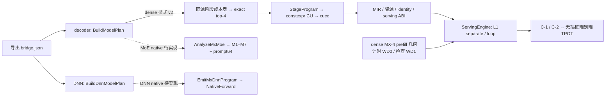
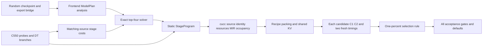

# MX-5 C550 pipeline and specification audit

以下为当前源码的只读核对（verified）；逐格数字以 [LLM 表](MX5_llm_c550.md) 和
[主报告](MX5_c550.md) 为准。dense v2 已实现并在显式入口验收，默认 target 仍指向
MX-4。MoE/DNN 的 native 客户尚未实现，旧 DM 路径仍存在，本轮没有执行它们。

| prompt 要求（stated） | 当前执行边界（verified） |
|---|---|
| 阶段顺序 | dense decode → MoE → LLM 30 格验收 → DNN；MoE 仅完成 CPU 前端核对 |
| 默认值依据 | 仅无插桩 TPOT / forward 时延；四项 attention 实现对照均无可分辨收益，均未采用 |
| 原始基线 | MX-4 三份固定 CSV 保持原字节；没有外部基线重测 |
| 每格选择 | 已完成格的原始 top-4 全部 C-1/C-2，两个新进程计时，再按 1% 规则选择 |
| 允许的修订 | 用户允许已探测纯 LDS 局部同步，并放宽累计 60 GPU 小时上限；其余判据保留 |
| GPU 作业 | 卡号限 7/6/5/4、最多两卡、每卡一个 guard；单作业及计时时限保留 |
| 未关闭的门 | 已确认的性能回归及 GEMM 576 精度边界失败分别保留；不据此宣称 G-B/G-LLM 通过 |

MoE 实现前已核对实际五个 B：24 层序列、779 个缓冲、219 个 legacy stage、
121 个 GEMM、246 项外部名字/dtype/recipe、FP32 路由权重和 BF16 Q/K norm、RoPE。
这些是 CPU 前端事实，不等于 native 编译、路由正确性或性能验收。
具体入口及待补文件见下文；最终 xcore1000 的 MoE/DNN 需编译期拒绝 legacy 路径。

---

Verified checkpoint, 2026-10-28: A19 body `7c9658ac5`, frozen normal producer
`88327cbc4`, has11/25 dense top-four selections. Eight are nonregressions;
Qwen0.6B B2/B4 andQwen1.7B B2 are9.823/7.591/1.538% slower than fixedMX4;G-LLM stays open.
Current consumed-prefetch4b7d83686/producer230a572b has4 earlier L2-prefill measurements;25/25 aligned L1-prefill selections. Earlier L2 results: Llama1B B1
2.135062ms(−3.438%);QwenB1=1.973800ms(−.492%,indistinguishable);Llama1BB16=3.006219ms(−12.490%).
QwenB16=3.517390ms(−22.475%). Aligned L1 Llama1B B2=2.264237ms(−.342%,indistinguishable).
Aligned L1 Llama1B B4=2.428614ms(-0.415%).
Aligned L1 Llama8B B16=13.136274ms(−9.662%),pred/meas.99385.
Aligned L1 Llama1B B8=2.648571ms(-4.426%).
Aligned L1 Qwen0.6B B1=1.973795ms(-0.492%,indistinguishable).
Aligned L1 Qwen0.6B B16=3.517579ms(-22.470%).
Aligned L1 Llama1B B1=2.134784ms(-3.450%),pred/meas1.01338.
Aligned L1 Llama8B B1=10.584414ms(-1.224%),pred/meas.98285;G-PROGRAM fivecells passes.
Aligned L1 Llama1B B16=3.006684ms(-12.476%),pred/meas1.00474;allfive Llama1B batches complete.
Aligned L1 QwenB8=2.810405ms(-7.569%),actualtop4 selects1,pred/meas1.02062.
Current QwenB2/B4=2.301375/2.575878ms,+9.825/7.588% vsfixedMX4;three current G-LLM failures (addsQwen1.7BB2+1.507%),D7 ongoing.
Aligned L1 Qwen1.7BB1=3.267951ms(-4.578%),selects0,pred/meas1.02160.
Aligned L1 Qwen1.7BB2=3.609036ms(+1.507%),selects0,pred/meas.96038;currentregression.
Aligned L1 Qwen1.7BB4=3.919983ms(+.657%,indistinguishable),selects0,pred/meas.97085.
Aligned L1 Qwen1.7BB8=4.256901ms(-7.537%);25current aligned selections.
Aligned L1 Qwen1.7BB16=5.183361ms(-17.101%),pred/meas.99586;allfive Qwen1.7B batches complete.
Aligned L1 Llama3BB1=5.202121ms(-2.161%),selects0;allfourC1/C2512 andeightfresh timings pass.
Aligned L1 Llama3BB2=5.451367ms(-.481%,indistinguishable),selects0;allfourC1/C2512/eightfresh timings pass.
Aligned L1 Llama3BB4=5.700156ms(-1.843%),selects0,pred/meas.96955;strictoriginalinterpreter revalidation passes.
Aligned L1 Llama3BB8=6.105703ms(-6.532%),selects0,pred/meas.97895;allchecks/eightfresh timings andindependentappend pass.
Aligned L1 Llama3BB16=7.042876ms(-15.113%),pred/meas0.97491;allfiveLlama3B batchescomplete.
Aligned L1 Llama8BB2=11.089581ms(+1.463%),pred/meas0.96057;fourthcurrentregression;guard75discarded/retryguard0strictverificationpass.
Aligned L1 Llama8BB4=11.426354ms(+0.648%,indistinguishable),pred/meas0.96126;B8wasthenremaining;nowcomplete.
Aligned L1 Llama8BB8=11.862168ms(-2.824%),pred/meas0.97860;all25aligneddensecellscomplete,21nonregressions/fourfailures.
500A costs/25scopes pass;MoE0/5,DNN0/25 unfinished.

Authority: `/root/Prompt/TileMega_MX5_prompt.md`, SHA256
`75431f98a6286063cc73effe5ece2ed3d462304de4c4192dbd4023efe2bd6f73`.
Actual repository: `/root/tilemega`; initial HEAD `22a352242` on `tilemega-metax`.
Verified means inspected/executed here; stated means supplied instruction;
inferred means an interpretation. Earlier source cohorts remain in append-only
CSVs and git history; they do not count as a later body's acceptance.

## Actual entry routes and shared runtime (verified, 2026-10-29)

The export bridge records graph nodes,signatures andparameter recipes;it is not an
executable plan. Compile builds ModelPlan,selects/lower bodies,generates CU and
compiles plan.so. Python then binds the serving ABI;the ABI alone does not prove
that a native StageProgram was generated.

| Current route | Actual source/behavior | MX-5 boundary |
|---|---|---|
| Dense decode,default | compile.cpp:580→mx_decode.cpp:95;unmodified target stilluses MX4costs | MX4 static remains the default until MX5acceptance |
| Dense decode,explicit v2 | mx_decode.cpp:96/97 dispatches table preparation ormx_decode_v2 pin compilation;TryCompileV2:207 imports/analyzes dense ModelPlan | Current original4 selection route;constexpr StageProgram/L1;explicit pin builds are not themselves finalsolver acceptance |
| Dense prefill | Existing MX4 prefill geometry andlegacy serving harness;timingWD0,checksWD1;fragment KVwrite compatibility added | Allowed retained prefill path;not the decode interpreter andnot a dense-prefill redesign |
| MoE decode | TryCompile sets moe_batch and routes DM directly to TryCompileMoeV2/AnalyzeMxMoe | Native bodies/ABI/CLI integrated; missing qualified costs/model validation; no legacy fallback |
| MoE prompt64 | --mx-prompt 1 routes decode bridge through native emitter/runtime, seq64 | CPU ABI/identity pairs pass; GPU model validation remains open |
| DNN forward | compile.cpp:748 BuildDnnModelPlan→existing CouplingGraphToCUDA/serving harness;dnn/cli.py:58 defaultsL2,cli.py:229 defaultsbuild-dm compiler | mx_dnn.cpp/EmitMxDnnProgram/time command andfinallegacy rejection are still missing;no nativeforward result is claimed |

PlanLibrary inserving/plan.py binds tm_plan_query/buffer/create/set_steps/launch,
optional launch_steps/watchdog/timestamps,and destroy. ServingEngine checks
phase/shape/sharedKV,requires compatible kv_layout andkv_storage,loads recipes,
binds sharedweights/requeststorage,launches prefill then separate/device-loop decode.
execution.py:43 selects L1 for mx_static;prefill_mode=None inherits thatL1.
Identical external names across phases must have identical dtype/size/recipe
(serving/weights.py:109);this also constrains future MoE prompt/decode pairs.

DNN's existing NativeForward is indnn/check.py:30,not a new MX5compiler. It checks
forward phase/capacity/batch,binary_sha256 andthe exact external-name set,binds
checkpoint weights+inputs+outputs,and checks supported repeated launches. Reusing
this ABI/checker does not mean the requested static DNNbodies exist. DNNtiming must
use the specified50-forwards/device-events protocol rather than this check loop.

## Current dense pipeline (verified)

MX4 standard measure defaults prefill toL1. Earlier explicitL2 timing was a harness
deviation;allfour rows remain preserved but are outside aligned final acceptance.
The final default edge remains open. The global target still selects the MX-4
cost table; explicit v2 configuration selects the development native route.

| Step | Implementation and evidence boundary |
|---|---|
| Export | `mx_serving_cell.sh` creates decode/prefill bridge JSON. All five dense checkpoints and MoE-L24 export/checkpoint exist. Export alone is not native execution. |
| Analysis | `compile.cpp` routes xcore1000 decoder/decode to `mx_decode::TryCompile`. Dense imports `ModelPlan` and analyzes shapes. Native MoE routes directly to AnalyzeMxMoe/EmitMxMoeProgramV2; explicit diagnostic pins or a future measured solver are required. |
| Cost data | Current A20 pool reuses byte-identical G14/H15 evidence (3395 GEMM,750 head) and adds400 new512 attention keys, each three fresh processes. All25 scopes and independent top4 previews replay successfully. Another100576 attention keys were measured;300 failed resources and were not numerically executed. A cost scope does not authorize a plan thread shape. |
| Solver | Prescribed legal coordinates, five-length attention interpolation averaged over L65..1087, exact k-best top4. The source-bound Python resolved runner executes the four original candidates with preserved IDs and per-plan resource histories. |
| Codegen | `StageProgram` and `MxDecodeProgramV2` emit constexpr body types, direct calls and by-value bindings. No runtime stage descriptors. QKV(kStore), attention, O, gate_up, down, head give 5L+1 barriers. |
| Embedding and edges | Layer0 QKV reads the token embedding; layer0 O reads that residual. DownLast prefetches head; head prefetches next-step layer0 QKV weights. First token broadcast precedes entrance prefetch; later broadcasts follow grid acquire. |
| GEMM | Swapped MMA direction, prescribed TileRange/StreamK geometry, actual bounded ring refill, early residual, consumer RMS, fixed-order reductions and LA v2. TN/WN/D/Part/Pw are executed coordinates. |
| Attention | Single runtime-block-count body; block stream-K, online softmax, q/k transform, owned full-block cache writes, fixed-order wave merge and last-arriver partial merge. No Dispatch chain. |
| Head | Register argmax across tiles, one CTA reduction and parallel final partial loading; ties take the lower index. |
| Synchronization | DT-W/R/P/X/KV = 576 / role fence+atomic / P-B / X-A / block fragments. Per-plan 512 exceptions require their actual bounded history. Every grid barrier owns a 64B monotonic counter. |
| Build gates | Normal compile flags, source/archive/CU/macro/binary identity; frame0, static-smem0, MT≤227/255, actual one-CTA occupancy and selected steady-loop MIR checks. A failed build/query is retained and never treated as a timing. |
| Packing | `serving/weights.py` executes actual recipes and tile_pages packing, checks recipe conflicts and deduplicates shared weights. KV physical storage and capacity must match prefill/decode. |
| Prefill | Dense retains MX-4 geometry; WD0 timing and WD1 checks are separate artifacts. DT-KV block-fragment writes are required for the shared cache. TTFT is measured, not optimized. |
| Runtime | `DecodeRuntimeV2` retains L1/launch_steps ABI; `execution.py` resolves mx_static to L1. `ServingEngine` binds weights and shared request storage, runs prefill, then separate or device-loop decode. |
| Acceptance | Each original top4 candidate passes 512-step C-1/C-2 and two fresh WD0 timing processes, warm1/timed2, ISL64/OSL1024, greedy BF16. The fastest replaces prediction0 only if at least1% faster. |

Kernel-bound terminal packet scope and stage-local address-space binding reloads
are recorded integration differences in `MX5_integration_c550.md`. They are not
permission to change layouts, arithmetic, search coordinates or numerical gates.

## Decisions and amendments (verified / stated)

| Item | Evidence | Applied branch |
|---|---|---|
| DT-W | Poll N8/N0=12.65; arrival=9.04 | 576 synchronization wave; individually justified 512 exceptions |
| DT-R | Release atomic N8/N0=9.39 | Synchronization-role fence+atomicAdd |
| DT-P | CTA increase750ns > 387ns threshold; LDS increase−20ns | P-B with LDS generation release |
| DT-X | Wave exchange increase−20ns and no global wait there | X-A |
| DT-KV | Minimum K/W=.507, Vt/W=.363 | Full32-token block-fragment layout |

The user authorized the probed LDS-only primitive for local pure-LDS publication
and workspace reuse. Global P-B release/acquire and LA/global publication remain.
Five-fresh helper litmus covers 104CTAs×2000 iterations per process. The two local
LDS P-PAIR results (+.146%,−.300%) were indistinguishable, not demonstrated gains.

The user waived the original60-card-hour total cutoff on 2026-10-28. Cumulative
accounting continues; allowed cards7/6/5/4, at most two cards, one job/card, guard,
1800s job and900s timing caps remain. Current own jobs use6/5;all cumulative card time remains in the ledger. No clocks, power,
driver or other processes are changed; fixed external baselines are not rerun.

Original R_cap220/248 and prefetch formulas remain. A proposed R_cap160 change
has not been applied. The committed attention lifetime repair retains both caps.

## Open gates and next work (verified)

1. G-B remains open. The original576 GEMM seeded criterion fails one element:
   21.75 vs22.125, error.375 > tolerance.374000013. Native instrumentation preserves
   the complete original output. Observed normalized gate lies1.192e−6 below a
   BF16 midpoint while the CPU reference lies2.861e−6 above. No oracle, tolerance
   or seed was changed; this is localization evidence, not a repaired gate.
2. The old Llama1B576 PK2 self-next bench has44–48B frame despite a real
   whole-program167MT/frame0/resident1. This never justified blanket512. The
   consumed-prefetch repair has139/141MT/frame0/actualresident1. Full336, null28,
   helper6 andcoldselfnext12 each pass5fresh;normalproducer230a572b passes160/160;500 new attention costs are complete.
3. Original true576 Llama1B B2/B4/B8 watchdog builds fail16/24/56B before numerical launch.
   Their explicit bounded WD-pair histories now fit;allthree aligned L1 selections
   complete with unchanged original candidate IDs. Rejected lifetime prototypes stay off.
   G-PROGRAM now passesfive actual aligned development cells;G-SOLVER/G-LLM remain open. A19 has11 measured cells and three
   regressions. B2 DIAG attention is35.923/35.842us versus bench27.167us. Three
   fresh off-grid diagnostics explain much of the prediction gap; the mandated
   five-point grid/formula is unchanged. Current-source I1 five-fresh timing is complete
   (QKV+6.304%,attention+3.668%,O+8.104%,GU+7.224%,down−.478%);it is attribution only.
4. Complete all25 dense selections, then implement MoE analysis, router/top-k,
   dispatch, grouped GEMMs, combine, prompt64 and routing validation, five batches.
   Legacy MoE is not an accepted native result.
5. Complete LLM30 acceptance and CP-5 before native DNN execution. Implement
   forward ABI, all native bodies, register epilogues/layouts, cost table/top4,
   time command,25 synthetic checks and25 forward timings. Only DT-F may be cut
   for budget; its adoption still requires the prescribed P-PAIR evidence.
6. xcore1000 MoE native routing rejects legacy lowering; DNN rejection remains unfinished. The nine
   pre-existing legacy legality tests listed in MX-1 remain outside this repair.

Main results: `MX5_c550.md`, `MX5_llm_c550.md` and the append-only CSVs.
Detailed amendments: `MX5_scope_reaudit_20261027.md`, `MX5_local_lds_c550.md`.
The full task, all55 cells and final default promotion are not complete.

## MoE contract read-only preparation (verified, 2026-10-29)

A CPU-only observer links the unchanged frozen producer's actual frontend library
and reads the real MoE-L24 decode bridge. For allB1/2/4/8/16,BuildModelPlan and
ValidateDmModelPlan succeed:24layers,121GEMMs,219legacy stages,779buffers,epsilon1e−6.
The exact per-layer sequence is QKV→fused-attention→merge→O→router→topk→gate/up→down→combine.
The observer checks all120 blocks,not a synthetic substitute or48-layer fixture.

| Projection | N | K | Native use required by prompt |
|---|---:|---:|---|
| QKV |5120|2048|kStore+consumer RMS|
| O |2048|4096|residual|
| Router |128|2048|roundedBF16 logits+top8 dispatch|
| Expert gate/up |1536|2048|gather+indirect,folded gamma,deferredRMS+gatepair|
| Expert down |2048|768|indirect+scatter,then combine|

Actual topk routing dtype isf32;row_capacity=B×8,experts128,topk8. Router and
gate/up recipes fold the same actual post-attention gamma;expert interleave unit16.
Embedding,attention-merge,topk,combine andargmax fold into the specified native
program,whose required barrier count is6×24+1=145;no native MoE ran here.

Current entry gaps remain atmx_decode.cpp:105 (DM returns−1),mx_decode_v2.cpp:102/226
(explicit dense-only rejection),andMxDecode.h:11 (no prompt field). The early
mx_decode options omit moe_batch although ModelPlan defaults it to1;the observer
sets the actualbatch explicitly as§6.1 requires. No legacy GPU path was executed.

Serving weight_recipes rejects differing same-name recipe/dtype/size across phases
(weights.py:117);every future native prompt/decode candidate pair must therefore
share its exact recipes. Read-only preparation does not claim a generator,packing,
solver,correctness,routing-check,TTFT orTPOT result. Implementation remains after
the dense stage;rawmoe_native_contract_readonly_v1/ACTUAL_MODELPLAN5_CONTRACT.json.

Verified native MoE CLI/ABI integration: four B1/B16 prompt/decode CPU builds
share external rows, recipes and source digest; identities/resources pass.
Native stage sequence is 6L+1, prompt has 9217 releases. This is not model
acceptance or a 512-thread exception. The dense25+D7 gate is complete; MoE
router/combine and router-GEMM each pass five fresh GPU processes; grouped
unit work is in progress. Qualified costs/top4/C1C2/routing/E2E remain.
