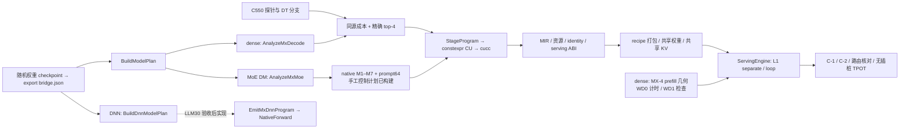

# MX-5 C550 pipeline and specification audit

当前核对为 verified（源码、构建或原始记录）；要求为 stated（MX-5 prompt）；
尚待实测的解释标为 inferred。权威文件是仓库外的
`/root/Prompt/TileMega_MX5_prompt.md`，SHA256：
`75431f98a6286063cc73effe5ece2ed3d462304de4c4192dbd4023efe2bd6f73`。
实际仓库 `/root/tilemega`，分支 `tilemega-metax`，起点 `22a352242`。
逐格数字见 `MX5_llm_c550.md`，MoE 证据见 `MX5_moe_native_c550.md`。

## 当前整体 pipeline（verified）

| 入口 | 当前代码与行为 | 验收边界 |
|---|---|---|
| dense decode 默认 | `compile.cpp` → `mx_decode::TryCompile`；target 仍指向 MX-4 成本 | 默认未提升到 MX-5 |
| dense decode 显式 v2 | `mx_decode_v2.cpp`、`MxDecodeSolverV2`、resolved runner | 25 格原始 top-4 已检查/计时，4 格回退仍未关闭 |
| dense prefill | MX-4 几何和 serving harness，支持当前 KV 片段写入 | WD0 计时、WD1 检查；未改造 prefill 结构 |
| MoE decode | `options.moe_batch=r.batch`；DM 计划直接进 `TryCompileMoeV2` → `AnalyzeMxMoe` | native 实现存在；缺合格完整成本、模型验收与终版选择 |
| MoE prompt64 | decode bridge + `--serving prefill --mx-prompt 1` | seq64、L1、同名同 recipe；B1/B16手工C-1/C-2通过，路由失败 |
| MoE 脚本 | 显式手工 PIN 接 native，decode 另建 watchdog twin，prefill 输入 decode bridge | 无 PIN 或请求未就绪求解入口时报错；不会落入旧脚本分支 |
| DNN forward | 当前仍为 `BuildDnnModelPlan` → legacy lowering/harness | native 客户和最终 legacy 拒绝尚缺；本阶段没有执行 DNN |

bridge 是图、签名及参数 recipe，不能单独执行。编译器分析 ModelPlan、选择几何、
生成静态 CUDA 源码，经 cucc 产出 plan.so。PlanLibrary 绑定 query、buffer、create、
set_steps、launch、launch_steps、watchdog 和 destroy；ABI 可加载不等于模型已验收。

ServingEngine 检查 phase、batch、seq、capacity、kv_layout 和 kv_storage，按 recipe
加载权重，绑定请求缓冲及共享 KV，执行 prefill 和 decode。`execution.py` 对
`mx_static` 选择 L1；MoE prompt manifest 为 `mx_static_prompt`。同名外部权重跨
phase 的 dtype、大小和 recipe 必须一致，MoE 实际 246 项已在 CPU 核对。

DNN 现有 `NativeForward` 位于 `dnn/check.py`，验证 forward ABI、binary SHA 和
checkpoint 权重∪输入∪输出的精确外部名集合。它不是 MX-5 native 编译器；仍需
`mx_dnn.cpp`、native 体、求解和 `time`。没有 DNN native 性能结果。

## dense v2 与成本选择（verified）

- typed StageProgram；按值绑定；无运行时 stage 描述符。QKV、attention、O、
  gate/up、down、head 共 5L+1 个屏障，Embed 并入第 0 层。
- QKV 使用 kStore；attention 执行 q/k-norm、RoPE、拥有者的整块 KV 写入、
  在线 softmax 和固定顺序归并。实际 KV 为 32-token block fragments，manifest
  仍保持 vt 接口；dense prefill 共享相同物理布局。
- GEMM 使用交换后的 MMA 方向、实际 TileRange/StreamK、ring、早发残差、consumer
  RMS 和 LA v2。head 跨 tile 在寄存器中 argmax，平局取小下标。
- DownLast 预取 head，head 预取下一步第 0 层 QKV；token 广播在 acquire 后、释放前。
  首次广播发生在入口预取之前。P-B 与 LA 的全局发布协议保持不变。
- 当前 A20 成本使用同源 G14/H15 的 3395 GEMM、750 head 行及 500 attention 行。
  每键三个新进程；资源失败与旧来源记录保留；不能从失败的 Pw0 参考直接排除实际载荷。
- attention 成本在 L={65,256,512,768,1088} 上插值，对 L65..1087 平均。
  精确 k-best 取原始 top-4，每个两个新进程；最快挑战者至少快 1% 才替换预测第 0 名。
- 100 个候选的 C-1/C-2（512 步）及 200 个无 watchdog 计时进程已完成。
  全部 pred/meas 为 .932689–1.024550；G-SOLVER 通过。

G-PROGRAM 五个 dense 开发格通过。dense 25 格中 21 格不回退，四格可分辨地慢于
固定 MX-4：Qwen0.6B B2 +9.825%、B4 +7.588%、Qwen1.7B B2 +1.507%、
Llama8B B2 +1.463%。G-LLM 保持未通过，未启用四个无可分辨收益的 attention 对照。

## MoE native 与当前工作（verified）

实际 MoE-L24 为 H2048/I768/E128/top8、32 query heads、4 KV heads、D128/Q8、
词表151936。每个 B 的前端计划有 24 层、219 legacy stage、121 GEMM、779 缓冲；
`AnalyzeMxMoe` 直接验证该序列，保留 246 项外部名字/dtype/recipe，排除 legacy scratch。

| native stage | 当前实现 |
|---|---|
| M1 QKV | `MxGemm` kStore + consumer RMS，N5120/K2048 |
| M2 attention | `MxAttentionV2`，Q8/hkv4/D128、q/k-norm、RoPE、整块 KV 写入 |
| M3 O | `MxGemm` residual，N2048/K4096 |
| M4 router/dispatch | BF16 logits、确定性 top8、legacy 权重舍入、active/rows/U 表 |
| M5 gate/up | `MxGroupedGemm`，gather、expert tile pages、consumer RMS、SwiGLU |
| M6 down/combine | expert partials、每 N tile 的 LA、按 rank0..7 累加、残差 |
| M7 head | dense head v2 |

每步 6L+1=145 个屏障。prompt 核内执行 past0..63，只在最后一步运行 head，
共 9217 次释放；prompt/decode 的外部表同名同 recipe。native CLI 拒绝解释式选项，
MoE decode/prompt 不再经 legacy 回退。当前只允许标记为 manual/resource_probe 的
手工计划；七类精确 k-best 已通过 720 个穷举对照，诊断候选CLI已接入；终版完整成本/选择仍缺。

原始三类 MoE unit 的 Python float torch.equal 仅证明值相等，旧文档的“逐位”表述
已纠正。新的严格 uint8 比较已完成三类各五个新进程，15/15通过。旧行、容差、种子和
原始二进制均保留；这些 unit 不能替代模型 C-1/C-2、路由核对或同步 litmus。

当前成本与集成工作：

- grouped 全域896个几何坐标：799个构建可运行，97个最终资源拒绝。初始772个坐标
  与恢复27个坐标均已完成三进程成本汇总；97个拒绝坐标另存正常编译证据。初始124拒绝的域摘要
  已更正，旧冻结 epoch 和原始记录保留，仅作为子集证据。
  按线程拆分：512为443 fit/5拒绝；576为356 fit（含恢复27）/92拒绝。
- qkv/o 的760个坐标：675个初始 fit，20个经减半恢复，65个最小预取仍失败。
  attention 另有100个512线程 fit、100个576线程 PK1 栈帧468–480B失败。
  795个可运行坐标的 MIR、设备查询和三进程成本汇总通过，另165个资源拒绝已核对。
- router 旧TN64/64的220个三进程成本保留为历史来源。排名谓词经整程序P-PAIR后合入，
  新一轮12种分派TN组合重建/查询/计时；已有8组各220个三进程成本完成。
  顺序几何汇总完成前5组，各540查询、220成本及50拒绝；其余汇总与测量在6/7卡继续。
- 候选组装已实现按分派TN分组的精确top4，匹配gate/up和down的实际TN、每层成本
  倍数、原始行索引；40组带平局穷举及两项host CTest通过，诊断CLI完整域检查已接入。
- 成本行导入已实现形状/执行器/资源/三轮契约检查与attention五点均值；922行真实
  grouped/head记录及15项负例通过。完整catalog和端到端选择仍缺。130个576线程head
  的三进程计时和汇总已完成，20个资源拒绝已核对；head全域300结果齐全。
- 普通四个512线程 native CLI 构建和六个 API0 查询已有证据。新增 B1/B16 的
  decode/prompt watchdog1 手工控制计划 MT237/241/245/249、frame/static0；设备
  查询与512步 C-1/C-2 已通过；新谓词八计划实际resident1/frame0，仍无终版模型结论。
  新576最小预取四计划实际resident1，但frame464–512B，继续拒绝；没有per-plan512例外。
- 路由审计脚本已实现并通过CPU边界测试；手工B1/B16的1536/24576个位置中，
  31/468个位置超过两BF16-ulp边界并失败（另有123/2282个边界平局）；门未通过。
  每项成本校验绑定源码、二进制、实际查询、PID、guard 和 raw hash；未齐表不作终版选择。
- B1手工C-2的512步两臂零差异。首轮内存统计缺`pair_u32`，修复后C-1又因MetaX
  PyTorch不支持grouped_mm停止。两轮失败保留；用户已授权HF正确性/路由参考显式
  使用eager，阈值和外部基线不变。新轮B1/B16的512步C-1/C-2均通过；最大gap
  为.0625/.109375，gap≤.5比例均1；两臂均零差异。仍为未选定的手工控制计划。

## prompt 不变量、修订和未关闭的门

| 要求或探针 | 当前执行边界 |
|---|---|
| 顺序（stated） | dense → MoE → LLM30 验收/CP-5 → DNN；当前在 MoE，DNN0/25 |
| DT-W（verified） | polling N8/N0=12.65、arrival=9.04 → 576 同步 wave；512 逐计划处理 |
| DT-R（verified） | release atomic 随 N 增长 → 同步角色 fence+atomicAdd |
| DT-P（verified） | CTA 增750ns、阈值387ns；LDS 增−20ns → P-B |
| DT-X（verified） | wave 交换增−20ns、交换处无全局等待 → X-A |
| DT-KV（verified） | 最小 K/W=.507、Vt/W=.363 → block fragments |
| 用户修订（stated） | 允许纯LDS局部同步、放宽累计60卡时、HF参考显式eager、仅补齐预取减半到D；其他判据保留 |
| 局部同步（verified） | 五新进程×104 CTA×2000次 helper litmus；P-PAIR +.146%/−.300%，无可分辨收益 |
| GPU（verified） | 仅7/6/5/4，最多两卡、每卡一作业，全经 guard；当前6/7；1800s一般/900s计时上限保留 |
| 编译/资源 | 正常编译参数；frame/static0、MT≤227/255、实际 resident1；R_cap220/248 未改 |
| 基线/数据 | 固定 MX-4 三份 CSV 原字节保留，不重测外部基线；runs 不入 git；测量行只追加 |
| 默认/性能 | 仅无插桩 TPOT/forward 决定默认；target 仍为 MX-4；TTFT 照常记录 |

G-B 仍有原始576 GEMM数值门失败：21.75 对22.125，误差.375超过容差.374000013。
instrumentation 保持原输出，归一化 gate 分别位于 BF16 中点两侧；尚未修复，
未修改 oracle、容差、种子或舍入契约。四格 dense 回退及 measured/bench>1.2 的阶段
按 D7 保留账本、MIR、预取、划分和 I1 归因，不能宣称 G-LLM 已通过。

MoE 手工 B1/B16 C-1/C-2 已过；路由核对仍失败31/468处，五格求解终版未完成。
排名谓词等价改写经整程序 P-PAIR 两格均快约3.7%后合入，新router成本重新标定。
regular795个三进程成本已齐，另165个资源拒绝；LLM30/CP-5 尚未完成。
DNN 的 StageProgram 客户、各 native 体、打包、成本/top-4、time、25格检查/计时及
legacy 拒绝均待 LLM 验收后推进。唯一可因预算裁剪的实现仍为 DT-F 两项融合；
用户放宽卡时不改变其他结构和验收要求。九个历史 legacy 合法性测试不在本轮修复。

主报告 `MX5_c550.md` 保持≤260行，LLM报告≤200行。最终还需总报告、55格对照、
逐阶段去向、起止HEAD/提交/推送、GPU使用、未完成 file:line 和单列相悖推断。
所有历史来源与失败过程保存在 git、append-only CSV 和 runs；尚未完成最终验收。

Verified 单点D7重放在相同embedding输入下已见QKV差异（relativeL2 .0025998894）；
CPU重现prompt的folded-W/consumer-RMS与HF的activation-RMS舍入位置，得到近似相同差异。
给HF router同一native残差后，该点由完整HF输入的3ULP失败变为2ULP平局；完整路由门
仍失败31/468，未改变算术或判据。详见MoE报告及moe_qkv_rounding_attribution_cpu_v1。
