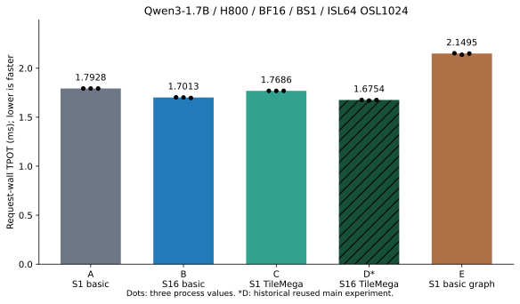
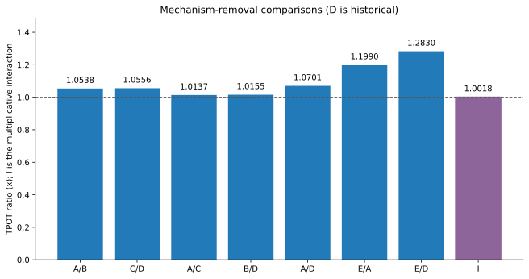

# SM90 mechanism-removal A-E: Qwen3-1.7B

Verified performance-only scope: H800, TP1, BF16, BS1, ISL/OSL 64/1024. Branch `sm90-decode-mechanism-ae-v1` starts at `4a84be39988967cb0a3c8f30c532bd25a6587960`. D is the unchanged historical main-experiment value 1.6754311115689438 ms, originally built from `4b9d1362e648e2ee2cc7f96da9422f97a6d36c45`; no D job was submitted.

Operator-local here means the prescribed unsplit S1 attention baseline, not a newly searched or measured local optimum. Only attention.chunks, group_wait and emb differ from D. GEMM geometries, MMA, warp layout, slots, register stages, residency, cluster and task-body source remain fixed. S1 has 8 attention tasks per layer and writes final context directly; S16 has 128 tasks and uses the existing partial-result LA merge.

Basic disables both KV-group early release at QKV→attention and fused Head→embedding handoff. It retains aggregate stage barriers, the same cyclic/grid-stride ownership, typed order and folded argmax. TileMega restores those two coordination mechanisms. This experiment does not isolate placement or order search.

E.json is byte-identical to A.json; their emitted body aliases and NativeProgram prefix are byte-identical. E uses the inherited preserve-body sequence branch: its graph contains embedding, the five typed stages per layer and folded Head in order, with kernel completion carrying cross-stage order. The captured graph is replayed for each decode step; capture is outside timed generation. kEmbed=false keeps the embedding stage every step; kPostHead=false avoids a separate argmax kernel. Binary symbol inspection verifies that A/B/C contain the persistent kernel without graph replay, whereas E contains stage kernels and cudaGraphLaunch without the persistent kernel. No task body or persistent path needed changes for this matrix, and no artificial work was added.

Verified protocol: A B C E / B C E A / C E A B on one physical H800, three independent processes per new arm. Each process has one warmup and three timed requests at N1 and N1024. TPOT = (median wall N1024 − median wall N1)/1023; the table uses the median of the three process TPOTs. Range = (max−min)/median × 100%. Historical prefill, name-seeded checkpoint algorithm/seed0, prompt and L1 decode-loop protocol are retained. No solve, calibration, microbenchmark sweep, C1/C2, HF, token/logit comparisons, sanitizer, stress tests or profiling were run. The existing driver checks output shape only.

| Arm | Decomposition | Plan | Execution | TPOT ms | Three process TPOTs ms | Range % | New/reused |
|---|---|---|---|---:|---|---:|---|
| A | Operator-local S1 | Basic: aggregate QKV release; embedding stage | Megakernel | 1.792820863 | [1.7931128572894512, 1.7927618338139262, 1.792820863138847] | 0.019579 | new |
| B | TileMega-selected S16 | Basic: aggregate QKV release; embedding stage | Megakernel | 1.701333413 | [1.7027887673476139, 1.7013334134777502, 1.6962223695125658] | 0.385956 | new |
| C | Operator-local S1 | TileMega: KV-group release; fused Head-to-embedding | Megakernel | 1.768624523 | [1.7686245229777098, 1.768253532738219, 1.7687533831884785] | 0.028262 | new |
| D | TileMega-selected S16 | TileMega: KV-group release; fused Head-to-embedding | Megakernel | 1.675431112 | [1.6761825522152982, 1.6701529110906572, 1.6754311115689438] | 0.359886 | reused |
| E | Operator-local S1 | Basic: aggregate QKV release; embedding stage | Typed-stage kernels + CUDA Graph | 2.149514393 | [2.152524155428959, 2.1369170928615184, 2.1495143929587446] | 0.726074 | new |

| Ratio | Value | Interpretation |
|---|---:|---|
| A/B | 1.053773969 | decomposition gain under basic planner |
| C/D | 1.055623541 | decomposition gain under TileMega planner |
| A/C | 1.013680880 | planner gain under operator-local decomposition |
| B/D | 1.015460082 | planner gain under TileMega decomposition |
| A/D | 1.070065400 | combined decomposition and planner gain |
| E/A | 1.198956592 | megakernel execution gain |
| E/D | 1.282961966 | total baseline to full TileMega gain |
| I | 1.001755189 | multiplicative interaction: (B*C)/(A*D) |

Inferred from these measured medians: S16/S1 decomposition contributes 1.0538x under basic and 1.0556x under TileMega. Restoring the two planner mechanisms together contributes 1.0137x under S1 and 1.0155x under S16. With identical S1/basic work, megakernel versus graph is 1.1990x. The interaction I=1.001755189 is near 1; this small departure does not establish a significant interaction from three processes and a historical D reference. The two planner mechanisms are bundled, so their individual contributions are not separated.

Verified observed ordering, fastest first: `D < B < C < A < E`. No process was selected or excluded for its measured speed. There were 0 guard/driver-rejected attempts, retained with reason and logs. Interpretation is limited to these two decomposition settings and the two bundled planner mechanisms. Comparisons containing D are cross-session and inherit historical variability. No numerical correctness claim is made from this performance-only run.

New GPU: `NVIDIA H800, GPU-73c1a37e-d3c0-dc24-b81d-6a5563ebe677, 00000000:0F:00.0`. Exact environment matching across all new and historical process records: `{"checkpoint_sha256": true, "mem_clocks": true, "model_config_sha256": true, "prompt_ids_sha256": true, "sm_clocks": true, "versions": true}`. Full clock sets and versions are in the process CSV. Existing namespace-limited GPU guard acceptance is retained: `provisional_container_pid_namespace`; unresolvable host PIDs are not asserted to have verified ownership. No GPU clock or power setting was changed.

Reproduction: `configs/serving/sm90_mechanism_ae/README.md`. Full precision binary hashes and process values are in the CSVs; static execution-path audit and artifact hashes are in the provenance JSON. Raw binaries, generated CUDA, compile logs, all guard attempts and every request measurement are retained at `/root/TileMega-mechanism-ae/runs/sm90_mechanism_ae` (not committed).
