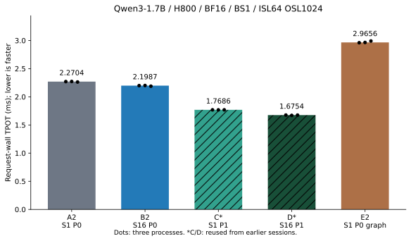
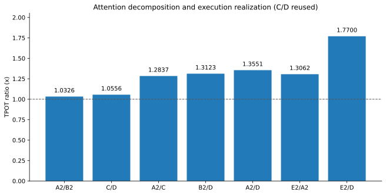

# SM90 explicit-stage realization ablation

Verified performance scope: Qwen3-1.7B, H800, BS1, TP1, BF16, ISL/OSL 64/1024. Branch `sm90-explicit-stage-ae-v1` starts at `7496665a83f857022f934c6474475be5f6862586`. C=1.7686245229777098 ms is reused from that mechanism-AE result; D=1.6754311115689438 ms is reused from the original R3 main experiment. C and D were neither rebuilt nor remeasured. Their original process records and binary identities are retained in the companion CSV and provenance JSON.

P0 is a prescribed explicit-stage realization, not a tuned operator-local optimum. P0/P1 changes fusion, preparation and completion together; it is not pure placement/owner/order search on a fixed task graph. E2/A2 measures execution organization with matched computation and task mapping; it is not pure launch latency.

Static implementation audit (not numerical validation):

| Mechanism | P0 implementation and source |
|---|---|
| InputNorm / gamma | `Sm90DenseExplicit.cuh::ExplicitRms` computes FP32 RMS statistics in the original MMA-fragment/WK reduction order. `Sm90DenseGemm.h` ExternalNorm disables in-GEMM square accumulation; `Sm90DenseEpilogue.h` consumes the inverse at the original output-scaling point. Existing gamma-folded weight recipes remain unchanged. No rounded normalized activation is introduced. |
| Residual | O/Down GEMMs use kStore into a reused BF16 workspace, followed by `ExplicitOutput<false>`. This preserves BF16(accumulator) before residual addition and the final BF16 rounding. |
| SwiGLU | Gate/Up GEMM retains original interleaved packing and writes BF16 gate/up once. `ExplicitOutput<true>` calls the original ServingEpilogueValue, including BF16 SiLU and product rounding. |
| Attention prepare | `ExplicitAttentionPrepare` invokes the original Prepare once per KV group, then stores prepared Q in-place. The ExplicitStages branch in `Sm90DenseAttentionBody.cuh` only loads prepared Q/new KV; it does not normalize, rotate or append again. |
| Attention mainloop / merge | Original MMA, TMA, online-softmax, task partition and partial/LSE format are retained. ExplicitStages disables last-arriver merge. S16 uses `ExplicitAttentionMerge` calling the original Merge; S1 writes context directly and has no merge stage. |
| Head / embedding | `ExplicitHeadPartialFinish` publishes local per-CTA best/index without final reduction or embedding. `ExplicitArgmax` performs the original final warp reduction, then the next step starts with independent embedding. No full vocabulary logits are materialized. |
| Boundaries / graphs | `ExplicitStageProgram` uses one typed list, per-stage aggregate counters, operand bank publication and cyclic/grid-stride task ownership. `ExplicitSequence` uses the same list and task mapping. Grid=132, threads=160, residency=1, cluster=1, and dynamic shared memory=217664 bytes remain fixed. |

S16 has 12 stages per layer and 340 native stages per decode step; S1 has 11 stages per layer and 312 per step. Both include initial embedding and three terminal stages (head statistics, head partial, final argmax). The imported semantic CTG still contains 143 stages; the dedicated native emitter expands it explicitly. The authoritative execution list is the generated NativeProgram, not the old five-stage CTG count. E2 uses that same expanded list, including every independent semantic operation; graph capture/initialization occurs during engine construction before timed requests. The existing per-step state-advance and per-request sequence-begin kernels are retained as execution-state bookkeeping. A2/E2 coordinates and generated Program prefix are byte-identical.

The specialized emit modes are `explicit-serving` and `explicit-kernel-sequence`, both with --tmexec-config and no solve. Coordinates retain geometry; the artifact manifest `realization=explicit_stages_qwen_b1_v1` and compiled type parameters describe the explicit merge/argmax overrides. P1 uses unchanged default template branches.

Protocol: A2 B2 E2 / B2 E2 A2 / E2 A2 B2, one physical idle H800, three independent processes per new arm, one warmup plus three timed requests at each N1/N1024. TPOT=(median wall N1024 − median wall N1)/1023; arm statistic is the median of three processes. Range=(max−min)/median×100%. Historical checkpoint seed0, prompt, prefill binary, L1 decode-loop and guards are retained. No C1/C2, HF, token/logit comparison, sanitizer, stress, profiling, other workload, sweep or calibration was run.

| Arm | Decomposition | Realization | Execution | TPOT ms | Three processes ms | Range % | New/reused |
|---|---|---|---|---:|---|---:|---|
| A2 | S1 | P0 explicit-stage | megakernel | 2.270441936 | [2.2704419364577126, 2.272355613879198, 2.2634054662700502] | 0.394203 | new |
| B2 | S16 | P0 explicit-stage | megakernel | 2.198721016 | [2.1987210156266075, 2.201235155426016, 2.1888716187886166] | 0.562306 | new |
| C | S1 | P1 selected | megakernel | 1.768624523 | [1.7686245229777098, 1.768253532738219, 1.7687533831884785] | 0.028262 | reused |
| D | S16 | P1 selected | megakernel | 1.675431112 | [1.6761825522152982, 1.6701529110906572, 1.6754311115689438] | 0.359886 | reused |
| E2 | S1 | P0 explicit-stage | typed-stage CUDA Graph | 2.965555377 | [2.960305161290403, 2.9655553773261754, 2.9910861026514586] | 1.037949 | new |

| Ratio | Value | Interpretation |
|---|---:|---|
| A2/B2 | 1.032619382 | S1/S16 attention decomposition under P0 |
| C/D | 1.055623541 | S1/S16 attention decomposition under P1 |
| A2/C | 1.283733154 | execution realization under S1 |
| B2/D | 1.312331495 | execution realization under S16 |
| A2/D | 1.355138938 | attention decomposition and realization combined |
| E2/A2 | 1.306157770 | matched explicit computation: execution organization, not pure launch latency |
| E2/D | 1.770025253 | total baseline-to-selected gain |

Inferred from the measured medians: attention decomposition contributes 1.0326x under P0 and 1.0556x under P1. The bundled execution-realization change contributes 1.2837x under S1 and 1.3123x under S16. These comparisons do not identify individual normalization, epilogue or completion contributions. Matched P0 megakernel organization contributes 1.3062x; the E2-to-D total is 1.7700x.

Verified observed ordering, fastest first: `D < C < B2 < A2 < E2`. Every prescribed valid measurement is included; no speed-based filtering was used. Guard/driver rejected attempts: 9 (all records retained). All ratios involving C or D are cross-session comparisons. No statistical interaction or numerical-correctness claim is made from this performance-only collection.

GPU: `NVIDIA H800, GPU-73c1a37e-d3c0-dc24-b81d-6a5563ebe677, 00000000:0F:00.0`. New/historical environment matching: `{"checkpoint_sha256": true, "mem_clocks": true, "model_config_sha256": true, "prompt_ids_sha256": true, "sm_clocks": true, "versions": true}`. Clock sets, software versions, prompt/checkpoint hashes, raw request times and binary hashes are in the process CSV. Existing namespace-limited PID acceptance is disclosed there; unresolved host PID ownership is not claimed to be verified. No clock or power setting was changed.

Reproduction and source locations: `configs/serving/sm90_explicit_ae/README.md`. All raw records, compile products and attempts: `/root/TileMega-explicit-ae/runs/sm90_explicit_ae`. Earlier result files are unchanged.
