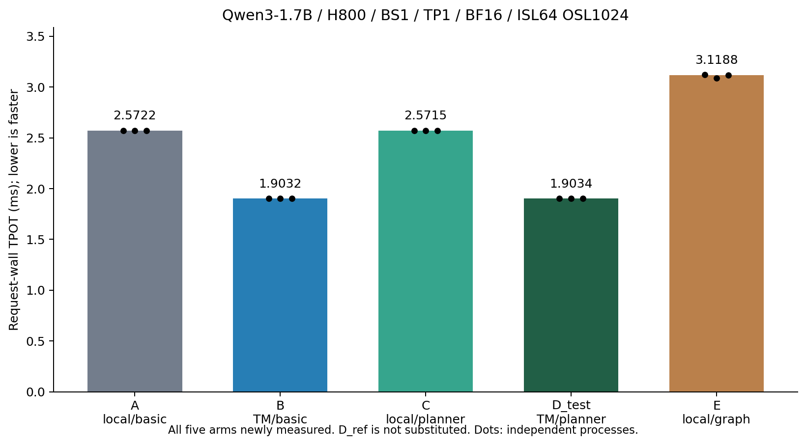
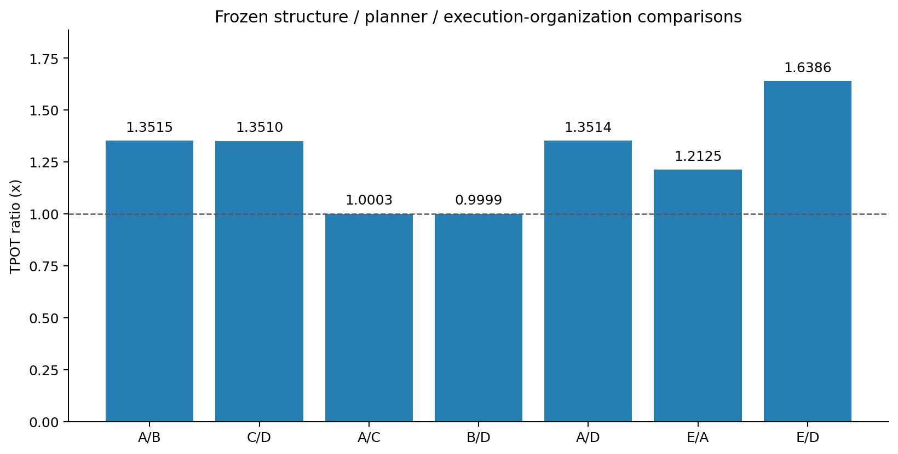

# SM90 operator-local × planner A–E

Verified: Qwen3-1.7B, H800, BS1, TP1, BF16, ISL64/OSL1024. All 15 matrix processes are new. D means D_test on the common static executor. Historical D_ref=1.6754311115689438 ms remains a separate, cross-session reference; it is never substituted.

| Arm | Structure | Planner | Execution | TPOT ms | Three processes ms | Range % | Source |
|---|---|---|---|---:|---|---:|---|
| A | S_local | P_basic | static task megakernel | 2.572160547 | 2.572160547, 2.571536764, 2.572279156 | 0.0289 | new |
| B | S_TM | P_basic | static task megakernel | 1.903220643 | 1.903441054, 1.903173181, 1.903220643 | 0.0141 | new |
| C | S_local | P_TM (Basic candidate retained on replay tie) | static task megakernel | 2.571497567 | 2.572107659, 2.571497567, 2.568633237 | 0.1351 | new |
| D | S_TM | P_TM (Basic candidate retained on replay tie) | static task megakernel | 1.903376915 | 1.903280022, 1.903376915, 1.904703658 | 0.0748 | new (D_test) |
| E | S_local | P_basic | stage kernels + CUDA Graph | 3.118809784 | 3.120900097, 3.087641484, 3.118809784 | 1.0664 | new |

| Comparison | Ratio | Interpretation |
|---|---:|---|
| A/B | 1.351477852 | decomposition and compatible implementation selection under Basic |
| C/D | 1.351018575 | decomposition and compatible implementation selection under TileMega planner |
| A/C | 1.000257819 | fixed S_local planning; selected task programs identical |
| B/D | 0.999917898 | fixed S_TM planning; selected task programs identical |
| A/D | 1.351366893 | combined structure and planning selection |
| E/A | 1.212525317 | matched task program: megakernel execution organization, not pure launch latency |
| E/D | 1.638566571 | full system versus stage-granular reference |

## Attribution

Verified planning outcome: both frontier candidates tie the Basic replay score. The declared tie rule retains Basic. The S_local frontier trial moved 672 task owners; the S_TM trial moved none. Neither trial replaced the retained Basic program. Thus A/C and B/D execute identical respective task programs. Their timing ratios measure repeatability here and do not demonstrate an executed owner/order optimization benefit.

S_local was independently selected from complete isolated-operator measurements before network timing. 2,383 candidates were enumerated; 196 survived the predeclared local-model screen and were measured. All valid samples are retained. Winners are best measured within this screened domain, not universal isolated optima. Attention independently selected S16/BK64/slots2/LA. Other selected parameters, local scores, complete candidate identities, input/cache protocol and raw paths are in [SM90_local_global_AE_qwen3_1_7b_b1/local_candidates.csv](SM90_local_global_AE_qwen3_1_7b_b1/local_candidates.csv) and the frozen S_local.json.

S differs in decomposition and compatible implementation, including the fixed local fusion boundaries. Local uses explicit norm statistics, Q/K preparation, residual and SwiGLU, and separate embedding; S_TM retains its original fused contracts. The head keeps bounded argmax completion in both structures; no full vocabulary logits are materialized. The S_local/ S_TM differences cannot be attributed solely to tile size. E/A changes whole-program execution organization with matched computation and mapping; it is not pure launch latency.

## Implementation and checks

* `sm90_local_global_local.py` and `sm90_local_global_operator.cuh`: predeclared joint candidate screen, native-body complete-operator timing, 256 MiB L2 eviction outside every sample, 3 warmups/15 samples, five weighted attention lengths.
* `Sm90DenseTaskCoordinate.cuh`, `Sm90DenseGemm.h`, `Sm90DenseAttentionBody.cuh`: explicit task coordinates consumed by producer addresses, consumer output coordinates and task counts. Defaults retain cyclic behavior.
* `sm90_local_global_plan.py`: common Basic RR/topological rule; common critical-frontier/earliest-finish/handoff search and replay with Basic retained as a candidate.
* `Sm90DenseStaticPlan.cuh`: common GPU-consumed static entries, per-track order and acquire/release event program for A–D; one compute task per ordinary entry. Head runs its assigned coordinate list once per track and finishes once.
* `Sm90DenseStaticSequence.cuh`: E uses A’s exact per-unit coordinate lists; kernel completion replaces cross-unit aggregate completion. Capture and initialization are outside timing.
* `sm90_local_global_emit.py`: explicit model-specific native ABI emitter; repacks each weight recipe, rebuilds all tensor-map boxes including an independent GateUp activation map, and resizes attention partial/LSE bindings.
* `sm90_local_global_audit.py`: unique task coverage, acyclic data/order graph, every logical dependency enforced by emitted waits/order, correct event producer counts, matched paired signatures, complete KV coverage and compiled coordinate/queue symbols.

These are static implementation checks and runtime exception checks. No C1/C2, HF, token/logit comparison, sanitizer, profiling or extra workload was run. Storage lifetime checks apply to the selected aggregate plans; no general arbitrary-plan race-free claim is made.

## Measurement and provenance

One physical H800: `NVIDIA H800, GPU-5b5e235a-09a2-fe8b-7754-916b7eb85976, 00000000:44:00.0`. Interleaving: ABCDE / BCDEA / CDEAB. Each independent process uses N1 and N1024, one warmup and three measured requests each. TPOT=(median wall_N1024−median wall_N1)/1023; each arm is the median of its three processes. The checkpoint, prompt, prefill binary and software versions match across all arms. The same seeded synthetic checkpoint protocol as the main experiment is retained.

31 end-to-end guard-rejected attempts were retained. No valid result was removed or selected by expected ordering. The inherited guard reports `provisional_container_pid_namespace`: container-visible owner checks pass, but host PID ownership is not independently proven. Idle power thresholds were remapped by physical UUID without retuning thresholds or changing clocks/power limits. All accepted local preflight samples also pass the correctly remapped threshold.

Raw measurements, failed attempts, generated sources, compiler logs and binaries: `/root/TileMega-local-global-ae/runs/sm90_local_global_ae`. Companion process CSV contains all timed wall samples, process IDs, raw measurement hashes and binary identities. Full A–D plans are archived under `configs/serving/sm90_local_global_ae/qwen3_1_7b_b1/plans/`; raw plan files and compiled source linkage remain under runs.

Reproduction commands and implementation limits: `configs/serving/sm90_local_global_ae/qwen3_1_7b_b1/EXECUTION.md`.

